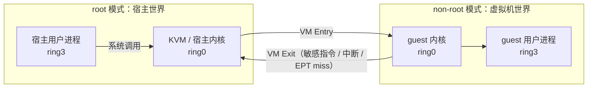
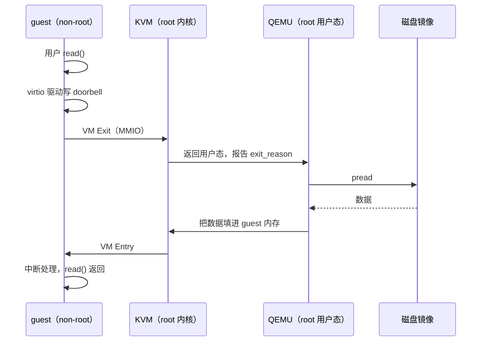

# CPU 工作模式：root 与 non-root

> [!info] 核心
> 开启虚拟化后，CPU 在硬件上被切成两个"世界"：
> **root 模式**跑宿主和 hypervisor，**non-root 模式**跑虚拟机。
> 两者靠 `VM Entry` / `VM Exit` 来回切换，**和 Ring 特权级是两条正交的轴**。

## 1. 一张图看懂

- guest 的普通指令**原生执行**，不经过任何翻译；
- 只有"guest 不能自己决定"的事，才 `VM Exit` 回到 root；
- guest 从头到尾**不知道自己不在 root 模式**。

## 2. 这两个模式的正名

| 厂商 | 宿主侧 | 虚拟机侧 | 状态档案 | 进入方式 |
|---|---|---|---|---|
| Intel VT-x | **VMX root operation** | **VMX non-root operation** | VMCS | `VMXON` |
| AMD SVM | **host mode** | **guest mode** | VMCB | `VMRUN` / `#VMEXIT` |

Intel 的进入顺序是：

| 步骤 | 动作 | 效果 |
|---|---|---|
| 1 | `CR4.VMXE = 1` | 允许使用 VMX |
| 2 | `VMXON(VMXON 区域)` | 当前逻辑 CPU 进入 root 模式 |
| 3 | `VMLAUNCH` / `VMRESUME` | 进入 non-root，guest 开始跑 |
| 4 | `VMXOFF` | 退出 VMX operation，回到普通模式 |

`VMXON` 是**每个逻辑 CPU 各做一次**的，不是整机一次。

## 3. 两个世界的能力差异

这是理解一切虚拟化行为的钥匙：

| 操作 | root 模式 | non-root 模式 |
|---|---|---|
| `VMXON` / `VMXOFF` | ✅ | ❌ `#UD` |
| `VMLAUNCH` / `VMRESUME` | ✅ | ❌ `#UD` |
| 读写 VMCS（`VMREAD`/`VMWRITE`） | ✅ | ❌ |
| `INVEPT` / `INVVPID` | ✅ | ❌ |
| 改 `CR0`/`CR4` 的"宿主保留位" | ✅ | 被 VM-execution controls 限制 |
| 访问物理地址 | 直接 | 多一层 EPT 翻译 |
| 收外部中断 | 正常 | 可配置成"先 exit 给宿主" |
| 执行 `hlt` | 正常 | 通常触发 exit |
| 执行 `cpuid` | 正常 | 可配置成 exit（由宿主伪造结果） |
| 端口 I/O | 正常 | 受 I/O bitmap 控制，可逐端口拦截 |
| 读写 MSR | 正常 | 受 MSR bitmap 控制 |

一句话：**non-root 里的 guest 内核虽然也是 ring0，但它是个"被缴了械的 ring0"**——它管不了 VMCS，也关不掉上面这些拦截。

## 4. 切换是怎么发生的

### 4.1 进虚拟机：VM Entry

`VMLAUNCH`（第一次）或 `VMRESUME`（之后）执行时，硬件做三件事：

1. 从 **VMCS 的 guest-state 区**把 guest 的寄存器、`CR0/3/4`、`EFER`、段、`RIP/RSP` 装进 CPU；
2. 按 **VM-execution controls** 打开各种拦截（I/O bitmap、MSR bitmap、异常位图、EPT）；
3. 切到 non-root，从 guest 的 `RIP` 开始执行。

VMCS 里的 guest 状态不合法时会发生 **VM-entry failure**：不进入 guest，直接在 root 模式报错，错误码写进 VMCS。

### 4.2 出虚拟机：VM Exit

触发条件可以是：

- guest 执行了被拦截的指令（`hlt`、`cpuid`、`rdmsr`、端口 I/O…）；
- guest 访问了 EPT 里没映射的页；
- 外部中断到了，且配置了 "external-interrupt exiting"；
- guest 主动 `VMCALL`（相当于 hypercall）；
- guest 触发 triple fault。

硬件做与 Entry 相反的事：把 guest 状态存回 VMCS，装回 **host-state 区**，回到 root，从 `VMLAUNCH/VMRESUME` 的下一条指令继续——也就是回到 KVM 的 `KVM_RUN` 返回处。KVM 随后读 `exit_reason` 决定怎么处理。

> 关键：**VM Exit 不是函数调用，是"换整个世界的状态"**。代价远高于普通系统调用。

## 5. VMCS：两个世界共用的"交接档案"

一个 vCPU 一份，里面分四块：

| 区域 | 存什么 |
|---|---|
| **guest-state** | guest 的 `RIP/RSP/RFLAGS`、`CR0/3/4`、`EFER`、段寄存器、MSR、活动状态 |
| **host-state** | 宿主对应的同一套状态（VM Exit 时装回 CPU） |
| **VM-execution controls** | 拦截谁：I/O bitmap、MSR bitmap、异常位图、EPT 指针、中断窗口 |
| **VM-exit information** | 为什么退出：原因码、地址、错误码 |

因为 host 和 guest 的状态是**分开存**的，切换时不需要软件逐个保存寄存器——这是硬件虚拟化比二进制翻译快的根本原因。

## 6. 和 Ring 的关系：别再混了

这是最容易错的地方。**root/non-root 是"哪个世界"，ring 是"世界里的权限"**：

| 组合 | 谁在这一层 | 说明 |
|---|---|---|
| root + ring0 | KVM、宿主内核 | 执行 `VMXON`/`VMLAUNCH` 的必须是这一层 |
| root + ring3 | 宿主的普通进程 | 它们也在 root 模式里，只是没权限 |
| non-root + ring0 | guest 内核 | 看着是 ring0，但执行 `VMXON` 会 `#UD` |
| non-root + ring3 | guest 用户进程 | 和普通用户态几乎无差别 |

由此可得几条结论：

- **"root 模式" ≠ "ring0"**：宿主用户进程也在 root 模式，只是 ring3。
- **"ring -1" 只是俗称**：x86 没有编号 -1，它指的就是 root 模式。
- **guest 的 ring0 不是真 ring0**：它改不了 VMCS，也关不掉中断拦截。
- 实模式/保护模式/长模式是**另一条轴**（地址翻译和位宽），和 root/non-root、ring 都正交。三者可以同时描述一颗 CPU：比如"non-root + 长模式 + ring0"就是 guest 内核的常态。

## 7. 一次完整往返：guest 读磁盘

每一步的细节见 [[virtio-blk 前后端]]。只有 **KVM 处理 exit、QEMU 读盘、再 VM Entry** 这几步在 root，其余都在 non-root 原生跑。

## 8. 为什么性能全看 exit

guest 算得再快，也架不住频繁进出：

- 每次 exit 要保存/恢复整套状态，还会污染缓存和 TLB；
- 设备 I/O 天然是 exit 大户（所以要 virtio、ioeventfd、vhost）；
- 中断如果全走 exit 会很贵（所以要 APICv、posted interrupt）；
- 缺页如果都交给 QEMU 会很贵（所以要 EPT，让 KVM 在内核里直接补）。

**虚拟化优化的一句话总结：让该在 non-root 干的事别回 root。**

## 9. 对照表

| | Intel VT-x | AMD SVM | ARM |
|---|---|---|---|
| 宿主模式 | VMX root | host mode | EL2 |
| 虚拟机模式 | VMX non-root | guest mode | EL0/EL1 |
| 状态档案 | VMCS | VMCB | 系统寄存器 + `HCR_EL2` |
| 进入 | `VMLAUNCH`/`VMRESUME` | `VMRUN` | `eret` 到 EL1/EL0 |
| 退出 | VM Exit | `#VMEXIT` | 异常到 EL2 |
| 嵌套 | VMCS shadowing / 多份 VMCS | 嵌套 SVM | NV2 |

## 10. 速查

| 名词 | 含义 |
|---|---|
| root 模式 | 宿主世界，hypervisor 在这里，能操作 VMCS |
| non-root 模式 | 虚拟机世界，guest 原生执行，碰不到 VMCS |
| VM Entry | root → non-root，装 guest 状态 |
| VM Exit | non-root → root，存 guest 状态、报告原因 |
| VMCS | 两个世界的状态档案 + 拦截配置 |
| Ring | 每个世界内部的权限，和上面三个都正交 |

> [!tip] 记忆法
> **root/non-root 是"两个世界"，Ring 是"世界里的职级"。**
> guest 的 ring0 是"另一个世界的 ring0"，官不小，但管不到这个世界的事。
