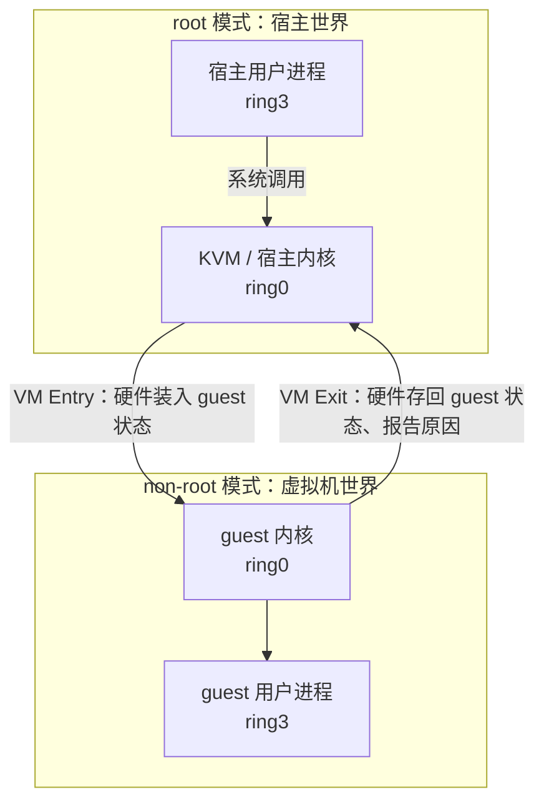
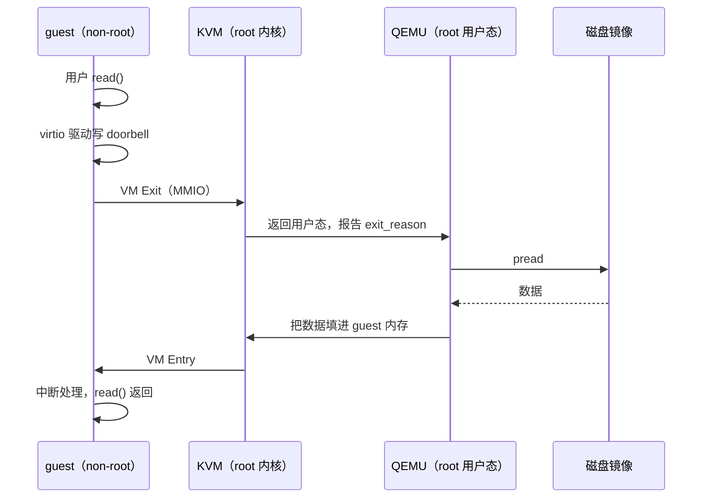

# CPU 工作模式：宿主与虚拟机（root / non-root）

> [!info] 怎么读这篇
> 你不需要先懂任何虚拟化名词。**先读 §3"四个零件"**——它用"解决什么问题"的方式解释 VM Entry/Exit、VMCS、EPT、拦截规则；后面几章只是把这四样拆开细讲。
> 全文只假设你学过 OS：知道 ring0/ring3、页表、系统调用、进程上下文。

## 0. 为什么非要再加一层"世界"

先认识两个词：

- **hypervisor**：管虚拟机的软件层。KVM 是 Linux 内核里的那一部分。
- **guest / host**：虚拟机叫 guest，宿主机叫 host。

普通 OS 靠 ring 检查就能挡住用户程序：用户态执行 `hlt` 会 `#GP`，改页表也会 `#GP`。

但虚拟机里**也有一个内核**，它也要 ring0。如果让它货真价实地跑在 ring0：

- 它执行 `hlt`，宿主 CPU 就真睡了；
- 它改 `CR3`，改的就是宿主的页表基址；
- 它发中断、关中断，会影响整台物理机。

**ring 检查防的是"用户态"，防不了"另一个内核"。** 所以硬件在 ring 之上又切了一层：

```
root 世界（宿主）         ← 真正的 ring0 在这里
  └ non-root 世界（虚拟机）← guest 的 ring0 在这里，比宿主低一层
```

guest 的内核在自己世界里是 ring0，但在硬件看来它仍在 non-root，越不过宿主。这就是全部设计的出发点。

> [!warning] 名词陷阱
> "root 模式"和 Linux 的 root 用户**没有任何关系**。前者是 CPU 的硬件状态，后者是操作系统里的用户 ID。

## 1. 一张图看懂



三句话：

- guest 的普通指令**原生执行**，不翻译、不解释；
- 只有"guest 不能自己决定"的事，才 `VM Exit` 回到 root 让 KVM 处理；
- guest 全程**不知道自己不在 root 模式**——它以为自己在管一台真机器。

## 2. 这两个世界的正名

| 厂商 | 宿主侧 | 虚拟机侧 | 指令集叫法 | 状态档案 |
|---|---|---|---|---|
| Intel | **VMX root operation** | **VMX non-root operation** | VT-x / VMX | VMCS |
| AMD | **host mode** | **guest mode** | SVM | VMCB |

"VMX" = Virtual Machine Extensions，Intel 那套虚拟化指令。开启它要按 CPU 逐个来：

| 步骤 | 动作 | 效果 |
|---|---|---|
| 1 | `CR4.VMXE = 1` | 允许这个核使用 VMX 指令 |
| 2 | `VMXON(一块内存)` | 这个核进入 root 模式 |
| 3 | `VMLAUNCH` / `VMRESUME` | 进入 non-root，guest 开始跑 |
| 4 | `VMXOFF` | 退出虚拟化状态，回到普通模式 |

**虚拟化状态是"每个逻辑 CPU 一份"的**，不是整机一个开关。8 核机器上，KVM 要在 8 个核上各 `VMXON` 一次。

## 3. 四个零件：先知道它们在解决什么

把"运行一台虚拟机"拆开，其实只有四个问题：

### 3.1 VM Entry / VM Exit：CPU 怎么借出去、又怎么收回来

**问题**：CPU 一次只能跑一条指令流。guest 跑的时候，宿主就停着，KVM 也没法盯着每一条指令（盯着就等于解释执行，慢几十倍）。

**办法**：硬件替你盯一张"敏感事件清单"。guest 一旦碰到清单上的事，CPU 自动停下 guest、保存现场、跳回宿主——这叫 **VM Exit**。宿主处理完，再执行 **VM Entry** 把 CPU 还给 guest。

**没有它会怎样**：要么每条指令都由软件模拟（极慢），要么 guest 完全失控（能碰宿主内存、能让物理核停机）。

> 一句话：**VM Entry = 把方向盘交给 guest；VM Exit = 遇到红线，自动把方向盘抢回来。** 车一直是同一辆物理 CPU。

### 3.2 VMCS：交接的时候，状态记在哪

**问题**：每次切换，都要保存/恢复一整套 CPU 状态（`RIP`、`RSP`、`CR3`、段寄存器、MSR……）。如果让软件一条条 `push`/`pop`，光保存就要几百条指令。

**办法**：在内存里开一块固定格式的区域，硬件认这个格式，切换时**自己批量读写**。这块区域叫 **VMCS**。里面同时放三样东西：guest 的状态、host 的状态、以及"哪些事要打断"的规则。

**没有它会怎样**：每次进出都要软件手动保存上百个字段，虚拟化会慢到没法用。

> 一句话：**VMCS 是硬件认得的"交接班记录本"**，两班人的东西各放一格，换班时硬件照着本子换，不用人动手。

### 3.3 EPT：guest 的"物理内存"怎么变成真内存

**问题**：guest 内核要管理"物理内存"，会用自己的页表把虚拟地址映射到"物理地址"。但它绝不能碰宿主的真内存。

**办法**：翻译两次。


guest 内核以为自己在分配物理页，其实拿到的是 **guest 物理地址（GPA）**；硬件再悄悄过一层 **EPT** 翻成宿主物理地址（HPA）。guest 连 HPA 长什么样都不知道，自然碰不到别的虚拟机。

**没有它会怎样**：直接给 guest 真物理地址 → 它能读写宿主内存；每次访存都交给软件翻译 → 慢到无法接受。

> 一句话：**guest 看到的是酒店房号，EPT 是前台那张"房号 → 真实位置"的表。** 客人永远拿不到整栋楼的图纸。

### 3.4 拦截规则：guest 跑到什么时候该停

**问题**：guest 要原生跑才快，但有些动作必须让宿主知道：读磁盘、执行 `hlt`、查 CPU 型号、收外部中断……

**办法**：在 VMCS 里放一组开关和位图（bitmap）。某一位是 1 就拦截，是 0 就放行。I/O bitmap 管端口，MSR bitmap 管 MSR，异常位图管异常。

**没有它会怎样**：要么全放行（guest 失控），要么全拦截（每条指令都 exit，慢得不如模拟）。

> 一句话：**这是门禁名单**：名单上的人刷卡就报警，不在名单上的直接放行。

### 3.5 四个零件的关系

| 零件 | 解决什么问题 | 一句话 |
|---|---|---|
| VM Entry / Exit | 怎么切换、怎么抢回控制权 | 交方向盘 / 抢方向盘 |
| VMCS | 切换时状态放哪、规则放哪 | 交接班记录本 |
| EPT | guest 的内存怎么映射且隔离 | 第二层页表 |
| 拦截规则 | 什么时候该打断 guest | 门禁名单 |

## 4. VM Entry / VM Exit 展开

### 4.1 进虚拟机：VM Entry

执行 `VMLAUNCH`（第一次）或 `VMRESUME`（之后）时，硬件做三件事：

1. 照 VMCS 的 **guest-state** 区，把 guest 的寄存器、`CR0/3/4`、`EFER`、段、`RIP/RSP` 装进 CPU；
2. 照 **VM-execution controls** 打开这一轮的拦截规则；
3. 切到 non-root，从 guest 的 `RIP` 开始执行。

如果 VMCS 里的 guest 状态不合法，会发生 **VM-entry failure**：不进入 guest，直接在 root 报错，错误码写进 VMCS。

### 4.2 出虚拟机：VM Exit

常见触发原因：

- guest 执行了被拦截的指令（`hlt`、`cpuid`、`rdmsr`、端口 I/O）；
- guest 访问的页在 EPT 里没映射；
- 外部中断到了，且开了 "external-interrupt exiting"；
- guest 主动执行 `VMCALL`（相当于"我找 hypervisor 有事"，即 hypercall）；
- guest 触发 triple fault（三层异常都没人接，等于内核崩了）。

硬件做与 Entry 相反的事：把 guest 状态存回 VMCS，装回 **host-state**，回到 root，从 `VMLAUNCH/VMRESUME` 的下一条指令继续——也就是 KVM 的 `KVM_RUN` 返回处。KVM 读 `exit_reason` 决定怎么处理。

> [!warning] 别被名字骗了
> `VM Exit` **不是"虚拟机关机"**，也不是"程序退出"。它只是"这一次把 CPU 交还宿主"，处理完还会 `VM Entry` 回去。一台虚拟机每秒可能经历成千上万次 Exit。

### 4.3 和系统调用比一比

| | 系统调用 | VM Exit |
|---|---|---|
| 谁触发 | 用户程序主动 `syscall`，或中断 | guest 执行被拦截的操作，或中断/EPT |
| 切换范围 | ring3 → ring0，**同一个世界** | non-root → root，**换世界** |
| 保存什么 | 内核栈 + 少量寄存器 | 整套 CPU 状态，硬件批量写进 VMCS |
| 怎么回去 | `sysret` / `iret` | 再执行一次 VM Entry |
| 量级 | 几百纳秒 | 几微秒，视退出原因而定 |

> 关键：**VM Exit 不是函数调用。** 它不压栈、不传参，宿主原来的调用栈原封不动地冻结在那里，等下一次 Entry 才继续。

## 5. VMCS 展开

一个 vCPU 有一份当前 VMCS，可以理解成**硬件版的 PCB + 配置表**：

| 区域 | 存什么 | 类比 |
|---|---|---|
| **guest-state** | guest 的 `RIP/RSP/RFLAGS`、`CR0/3/4`、`EFER`、段寄存器、MSR | 进程上下文 |
| **host-state** | 宿主对应的同一套状态 | 被换出进程的上下文 |
| **VM-execution controls** | 拦截规则：I/O bitmap、MSR bitmap、异常位图、EPT 指针 | 系统调用表 + 页表基址 |
| **VM-exit information** | 为什么退出、退出时的地址、错误码 | 中断向量 + `errno` |

几个容易忽略的点：

- 它**不是代码，是内存里的一块数据**；CPU 只保存一个指向它的指针。
- 它由硬件校验格式，用 `VMREAD`/`VMWRITE` 访问，只有 root 模式能碰。
- 正因为两套上下文分开存，VM Exit 时硬件能批量刷写，不用软件逐字段保存——这是硬件虚拟化比二进制翻译快的根本原因。

## 6. EPT 展开

两层翻译各自负责什么：

| 层 | 谁维护 | 翻译 | 存在哪 |
|---|---|---|---|
| guest 页表 | guest 内核 | guest 虚拟地址 → GPA | guest 自己的内存 |
| **EPT** | KVM | GPA → HPA | 宿主内存，根地址写在 VMCS 里 |

几个推论：

- guest 分配的"物理页"只是 GPA，它可以连续、可以从 0 开始，随便它怎么想。
- guest 访问一个没映射的 GPA → **EPT violation** → VM Exit。KVM 通常在内核里直接补映射，不必惊动 QEMU。
- guest 无法访问别的 VM 或宿主内存：EPT 表里根本没有那些映射。
- 改了 EPT 之后要刷新缓存，这就是 `INVEPT` 的用途。

> 类比：guest 是住客，只知道"301 房"；EPT 是酒店后台的房态系统。住客可以随便装修 301，但永远不知道 301 实际在几号楼，也进不了 302。

## 7. 两个世界的差别

### 7.1 虚拟化指令：只有 root 能用

| 指令 | 作用 | 在 non-root 执行 |
|---|---|---|
| `VMXON` / `VMXOFF` | 开启/关闭虚拟化状态 | `#UD`（非法指令） |
| `VMLAUNCH` / `VMRESUME` | 进入虚拟机 | `#UD` |
| `VMREAD` / `VMWRITE` | 读写 VMCS | `#UD` |
| `INVEPT` / `INVVPID` | 刷新 EPT / TLB 缓存 | `#UD` |

如果 guest 能执行 `VMLAUNCH`，它就能自己再造一台虚拟机，等于越狱。所以硬件直接把这些指令对 non-root 隐藏。

### 7.2 guest 的 ring0 是"被缴了械的 ring0"

guest 内核仍能改自己的页表、开关自己的中断，但很多动作会被 §3.4 的规则表拦住：

| 动作 | 默认结果 | 为什么拦 |
|---|---|---|
| 改 `CR0`/`CR4` 的某些位 | 写了无效，或 `#GP`/exit | 这些位归宿主所有 |
| 读写某些 `MSR` | 按 MSR bitmap 决定是否 exit | MSR 控制 CPU 全局行为 |
| 端口 I/O | 按 I/O bitmap 逐端口拦截 | 设备在宿主手里 |
| `hlt` | 通常触发 exit | 不能让 guest 把物理核睡死 |
| `cpuid` | 可配置成 exit | 宿主需要伪造 CPU 型号 |
| 收外部中断 | 可配置成先 exit 给宿主 | 中断该给谁由宿主决定 |

### 7.3 中断与时间

- **中断**：外部中断可配置成"先 Exit 交给宿主"，由 KVM 决定投不投给 guest；guest 内部的 IPI 由虚拟 LAPIC 转发。
- **时间**：guest 读到的 TSC 是宿主调整过的（加偏移/缩放），否则它会发现时间对不上。
- **时钟**：虚拟定时器到期，KVM 注入一个中断，guest 的调度器才被唤醒。

## 8. 和 Ring 的关系：最容易混的地方

**root/non-root 是"哪个世界"，ring 是"世界里的权限"。**

| 组合 | 谁在这一层 | 说明 |
|---|---|---|
| root + ring0 | KVM、宿主内核 | 只有这一层能执行 `VMXON`/`VMLAUNCH` |
| root + ring3 | 宿主的普通进程 | 它们也在 root 模式，只是没有内核权限 |
| non-root + ring0 | guest 内核 | CPL=0，但执行 `VMXON` 会 `#UD` |
| non-root + ring3 | guest 用户进程 | 和普通用户态几乎没差别 |

四条结论：

- **root 模式 ≠ ring0**：宿主用户进程也在 root，只是 ring3。
- **"ring -1" 只是俗称**：x86 没有 -1，它指的就是 root 模式。
- **guest 的 ring0 只在本世界有效**：它管不了 VMCS，也关不掉中断拦截。
- **实模式/保护模式/长模式是第三条轴**：讲位宽和地址翻译，和 root/non-root、ring 都正交。三者可以同时描述一颗 CPU，比如 guest 内核的常态是"non-root + 长模式 + ring0"。

## 9. 一次完整往返：guest 读磁盘



细节见 [[virtio-blk 前后端]]。只有 **KVM 处理 exit、QEMU 读盘、再 Entry** 这几步在 root，其余全在 non-root 原生跑。

## 10. 为什么性能全看 exit

用 OS 经验类比：函数调用很便宜，系统调用贵一两个数量级，VM Exit 又比系统调用贵一两个数量级。所以虚拟化的性能问题，几乎都能翻译成"exit 太多了"：

| 问题 | 原因 | 优化 |
|---|---|---|
| 磁盘 I/O 慢 | 每次 I/O 都 exit 到 QEMU | virtio、ioeventfd、vhost |
| 网络慢 | 同上，还要拷贝 | vhost-net、vDPA |
| 中断多就卡 | 每个中断都 exit | APICv、posted interrupt |
| 缺页多就卡 | 早期每次缺页都交给 QEMU | EPT 让 KVM 在内核里直接补 |
| 定时器密集 | 每次到期都 exit | 虚拟定时器 + 免退出投递 |

一句话：**虚拟化优化 = 让该在 non-root 干的事别回 root。**

## 11. 三家对照

| | Intel VT-x | AMD SVM | ARM |
|---|---|---|---|
| 宿主模式 | VMX root | host mode | EL2 |
| 虚拟机模式 | VMX non-root | guest mode | EL0/EL1 |
| 状态档案 | VMCS | VMCB | 系统寄存器 + `HCR_EL2` |
| 进入 | `VMLAUNCH`/`VMRESUME` | `VMRUN` | `eret` 到 EL1/EL0 |
| 退出 | VM Exit | `#VMEXIT` | 异常到 EL2 |

ARM 没有"ring + 世界"两套坐标，而是合成一套 **Exception Level**：EL0 用户、EL1 内核、EL2 hypervisor、EL3 安全固件。别把两套模型混着套。

## 12. 术语表

| 名词 | 一句话解释 |
|---|---|
| **hypervisor** | 管虚拟机的软件层。KVM 是内核里的 hypervisor，QEMU 是用户态的 VMM |
| **guest / host** | 虚拟机 / 宿主机 |
| **root / non-root** | 宿主侧 / 虚拟机侧的硬件工作模式 |
| **VM Entry / Exit** | 进虚拟机 / 出虚拟机，硬件换整套状态 |
| **VMCS** | 每个 vCPU 一份的状态档案 + 拦截配置 |
| **EPT** | 第二层页表，把 GPA 翻译成宿主物理地址 |
| **GPA / HPA** | guest 物理地址 / 宿主物理地址 |
| **VM-execution controls** | 决定哪些动作要 exit 的规则表 |
| **`#UD` / `#GP`** | 非法指令异常 / 通用保护异常 |

> [!tip] 记忆法
> **root/non-root 是"两个世界"，Ring 是"世界里的职级"。**
> guest 的 ring0 是"另一个世界的 ring0"：官不小，但管不到这个世界的事。

## 13. 自测三问

1. guest 内核执行 `VMXON` 会怎样？为什么？
2. guest 以为自己在用物理内存，实际上它拿到的是什么？谁负责再翻译一次？
3. 同样是"陷入内核"，为什么 VM Exit 比系统调用贵得多？

（答案分别在 §7.1、§6、§4.3。）
