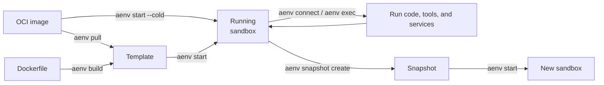
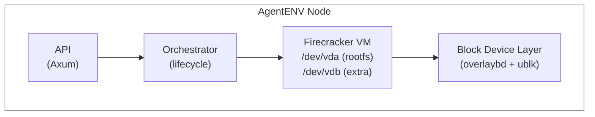

# AgentENV 工作原理

AgentENV 在相互隔离、支持快照（Snapshot）的 Linux 环境中运行 AI agent 及其工具。每个环境称为一个**沙盒（Sandbox）**，由一个 Firecracker microVM 支撑，拥有独立的内核、文件系统、进程和网络栈。

## 用户工作流

典型工作流如下：

1. 从 OCI 镜像或 Dockerfile 创建可复用的模板（Template）。
2. 从 Template 启动一个隔离的 Sandbox，或直接从 OCI 镜像冷启动一个 Sandbox。
3. 在 Sandbox 中运行命令。
4. 当希望保留同一个 Sandbox 以便之后使用时，暂停（pause）该 Sandbox；当希望获得可复用、能够启动新 Sandbox 的检查点时，创建一个 Snapshot。
5. 不再需要时，删除 Sandbox 和 Snapshot。

## Template、Sandbox 与 Snapshot

这三个概念描述了环境的可复用形态与运行形态：

| 概念 | 用途 |
|---|---|
| **Template（Template）** | 一个具名的、可复用的起点，用于启动 Sandbox。构建 Template 会在底层生成一个已提交的 Snapshot。 |
| **Sandbox（Sandbox）** | 一个运行中的、隔离的 Linux 环境，你可以在其中执行代码、修改文件并启动服务。 |
| **Snapshot（Snapshot）** | 从 Sandbox 捕获的持久检查点。它可以被反复启动，以捕获到的状态创建新的 Sandbox。 |

- 构建 Template 会生成一个由 Snapshot 支撑的起点。
- 启动 Template 或 Snapshot 会创建一个 Sandbox。
- 捕获运行中的 Sandbox 会创建一个 Snapshot，但不会替换源 Sandbox。

## 系统概览

## 请求流程

1. 客户端向 AgentENV API 发送 HTTP 请求（例如 `POST /sandboxes`）。
2. **API 层（API layer）**校验请求、检查身份认证，并将其转发给**编排器（Orchestrator）**。
3. **Orchestrator**管理 Sandbox 生命周期：它创建 Firecracker VM、设置网络并挂接块设备。
4. VM 使用**分层块设备（layered block device）**（overlaybd）启动，该设备将只读的基础镜像层与一个可写上层叠加起来。多个 Sandbox 共享相同的基础层。
5. 在 VM 内部，一个 **envd** 守护进程负责命令执行、文件操作和健康上报。
6. 客户端通过**反向代理（reverse proxy）**（`/proxy`、路由请求头，或已配置的 Sandbox 代理域名）与运行中的 Sandbox 交互，该代理会将 HTTP 和 WebSocket 流量转发到 VM 内部的服务。

接下来请阅读 [Templates](./templates/index.md)、[Sandboxes](./sandboxes/index.md) 和 [Snapshots](./snapshots/index.md)，了解每种工作流对应的命令与选项。
