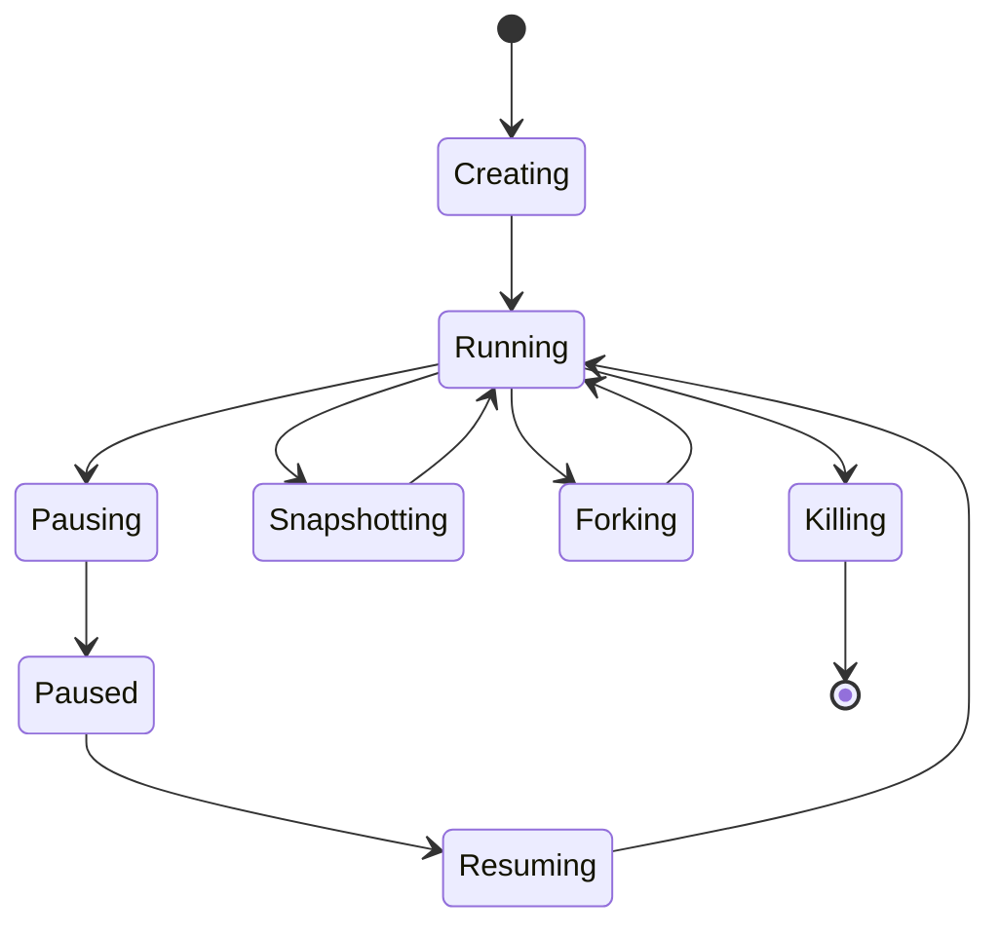

# Sandboxes（沙盒）

Sandbox 是一个隔离的 Firecracker microVM（微虚拟机），拥有自己的 Linux 内核、文件系统、进程和网络栈。它是你运行代码、使用工具、修改文件以及启动服务的环境。

Sandbox 会经历下图所示的生命周期。

| 状态 | 描述 |
|-------|-------------|
| **Creating** | VM 正在启动，块设备正在挂载，网络正在配置 |
| **Running** | VM 已就绪。可以执行命令，代理流量被路由，超时计时进行中 |
| **Pausing** | 正在捕获内存和磁盘快照 |
| **Paused** | VM 已停止。Snapshot 产物已存储。不消耗资源 |
| **Resuming** | 正在从其暂停 Snapshot 恢复 Sandbox |
| **Snapshotting** | 正在捕获持久化 Snapshot；之后 Sandbox 返回 Running |
| **Forking** | Sandbox 正在被克隆为子 Sandbox；之后源 Sandbox 返回 Running |
| **Killing** | VM 正在被拆除并释放资源 |

---

后续阅读：

- [启动 Sandbox](./starting.md) — 从 Template、Snapshot 或 OCI 镜像启动 Sandbox。
- [使用 Sandbox](./working.md) — 诸如连接、执行命令、传输文件、暂停、Snapshot、fork 和删除等基本命令。
- [自动驱逐](./auto-eviction.md) — 配置 Sandbox 的 TTL 和过期行为。
- [网络](./networking.md) — 配置 Sandbox 的入站和出站策略。
