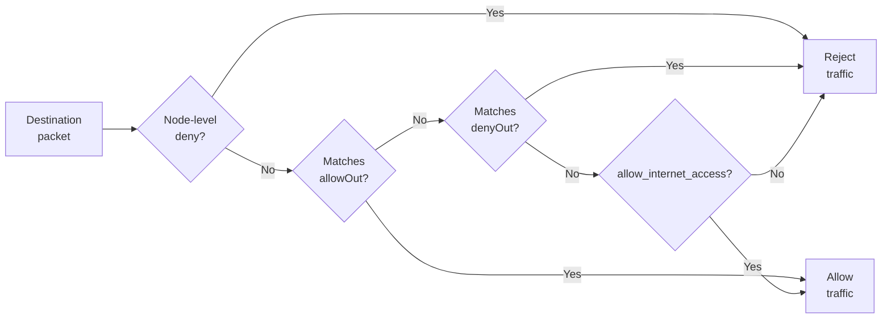

# 网络（Networking）

每个 Sandbox 都有隔离的网络栈。网络控制两个相互独立的边界：

- **出站（Egress）：** Sandbox 可以连接到哪些 IP 地址、CIDR 和域名。
- **入站（Ingress）：** 通过 AgentENV 代理暴露的服务是公开的，还是需要 Sandbox 流量访问令牌。

## 可配置的内容

网络配置有两个层级。在 AgentENV 配置文件中配置节点级防护措施；它们会应用到该节点上的每个 Sandbox。通过在 Sandbox API 请求中发送字段来配置 Sandbox 级策略。Sandbox 出站策略可在创建时设置，之后通过更新请求替换。

| 范围 | 字段 | 默认值 | 含义 |
|---|---|---|---|
| Sandbox | `allow_internet_access`（热）<br>`allowInternetAccess`（冷） | `true` | 基础出站策略。`false` 会拒绝未显式允许的目的地。 |
| Sandbox | `network.allowOut` | 空 | 允许的 IPv4 CIDR、IP 或域名模式。 |
| Sandbox | `network.denyOut` | 空 | 拒绝的 IPv4 CIDR 或 IP。不支持域名。 |
| Sandbox | `network.`<br>`allowPublicTraffic` | `true` | 代理服务是否公开。当为 `false` 时，请求需要流量访问令牌。 |
| Node | `[network.egress].`<br>`always_denied_cidrs` | 在 AgentENV 配置文件中配置 | 在 Sandbox 策略之前拒绝的 CIDR。Sandbox 的 `allowOut` 无法覆盖它们。 |

## 匹配规则

规则按以下顺序评估：



`allowOut` 可以覆盖重叠的用户配置 `denyOut`，但无法覆盖节点级的内部/保留网络拒绝规则。设置 `allow_internet_access: false` 会在显式规则之后添加一个默认拒绝的基础策略。

域名仅可在 `allowOut` 中用于 HTTP/HTTPS 连接。支持精确名称和诸如 `*.example.com` 的通配符形式。如果 `allowOut` 中包含域名，还应将 `denyOut` 设置为 `["0.0.0.0/0"]`；这会阻止其他目的地，并将列出的域名保留为允许的例外。

## 创建时配置

热启动和冷启动创建 Sandbox 都支持网络策略。

从 Template 或 Snapshot 热启动：

```bash
curl -X POST \
  -H 'X-API-Key: test-key' \
  -H 'Content-Type: application/json' \
  -d '{
    "templateID": "my-ubuntu",
    "network": {
      "allowOut": ["*.example.com"],
      "denyOut": ["0.0.0.0/0"],
      "allowPublicTraffic": false
    }
  }' \
  http://127.0.0.1:8000/sandboxes
```

从 OCI 镜像冷启动：

```bash
curl -X POST \
  -H 'X-API-Key: test-key' \
  -H 'Content-Type: application/json' \
  -d '{
    "image": "ubuntu:24.04",
    "allowInternetAccess": false,
    "network": {
      "allowOut": ["8.8.8.8/32"]
    }
  }' \
  http://127.0.0.1:8000/sandboxes-cold
```

## 更新运行中的 Sandbox

替换运行中 Sandbox 的出站策略：

```bash
curl -X PUT \
  -H 'X-API-Key: test-key' \
  -H 'Content-Type: application/json' \
  -d '{"allowOut": ["8.8.8.8/32"], "denyOut": ["0.0.0.0/0"]}' \
  http://127.0.0.1:8000/sandboxes/<sandbox-id>/network
```

更新会替换当前的出站规则。同时省略 `allowOut` 和 `denyOut` 会清空每个 Sandbox 的列表；同时省略 `allow_internet_access` 可恢复默认基础策略。

在当前实现中，更新主要影响新连接，不会主动终止现有连接。对于域名策略替换，旧策略会保持生效，直到安装新的命名空间规则并激活新的代理策略。
