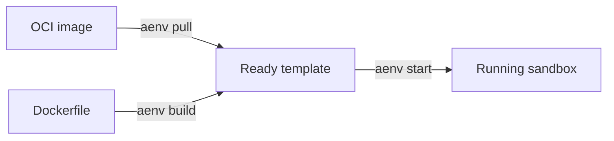

# Templates（模板）

Template 是用于启动 Sandbox 的可复用起点。构建或导入一次，然后在需要相同软件和配置时用它创建 Sandbox。

## 生命周期

## 与 Snapshot 的关系

Templates 是 API 和 UX 层。Snapshots 是持久的运行时层。

- 一次 Template 构建会发布一个已提交的 Snapshot。
- Template ID 或别名会解析到一个已提交的 Snapshot。
- 从 Template 创建的 Sandbox 会从该 Snapshot 恢复。

如果你希望了解 Template 底层的存储和运行时模型，请参见 [Snapshots](../snapshots/index.md)。

---

后续阅读：

- [创建 Template](./creating.md) — 从 OCI 镜像或 Dockerfile 创建 Template。
- [管理 Template](./managing.md) — 列出 Template、查看构建历史、解析别名以及删除 Template。
