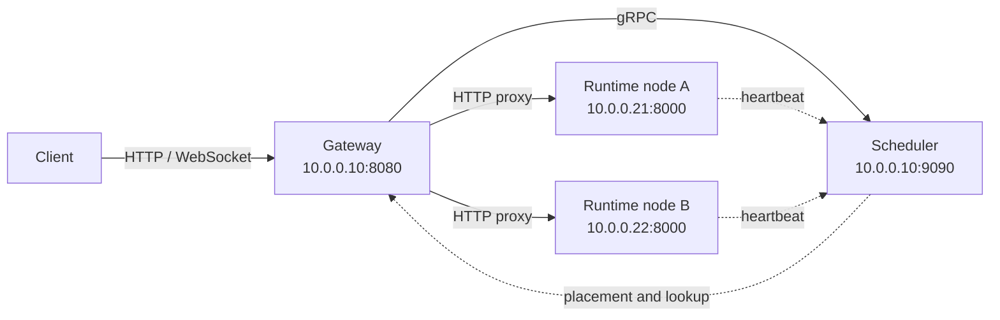

# 静态多节点（不使用 Kubernetes）

在不使用 Kubernetes 的情况下跨多台物理或虚拟机运行 AgentENV。此部署使用 Go Gateway 和 Scheduler，并采用静态配置的运行时节点列表。

当节点成员变化不频繁时，静态发现是合适的。Scheduler 不会根据心跳自动注册未知节点：每个运行时节点都必须出现在 `scheduler.nodes` 中，而更改该列表需要重启 Scheduler。

## 架构

此示例将 Gateway 和 Scheduler 部署在 `10.0.0.10` 上，并运行两个 AgentENV 运行时节点：

| 组件 | 地址 | 用途 |
|---|---|---|
| Gateway | `10.0.0.10:8080` | 面向客户端的 HTTP 和 WebSocket 入口点 |
| Scheduler | `10.0.0.10:9090` | gRPC 调度、心跳和沙盒绑定服务 |
| 运行时节点 A | `10.0.0.21:8000` | 以 `node-a` 运行 Firecracker Sandbox |
| 运行时节点 B | `10.0.0.22:8000` | 以 `node-b` 运行 Firecracker Sandbox |



AgentENV 会对 HTTP 请求进行认证，但不会加密它们。在流量跨越不受信任的网络之前，请使用私有地址、VPN 或 TLS 终结。

## 前置条件

在每个运行时节点上：

- Linux 内核 6.8+
- `/dev/kvm` 访问权限
- AgentENV 安装所需的 root 访问权限
- 到 Scheduler 的网络可达性
- 所有运行时节点间共享存储，使用 POSIXFS 或 OSS

在控制平面主机上：

- Go 1.21 或更高版本
- 到每个运行时节点的网络可达性
- AgentENV 仓库的检出副本

允许以下 TCP 流：

| 源 | 目标 | 端口 |
|---|---|---|
| 客户端 | Gateway | `8080` |
| Gateway | Scheduler | `9090` |
| 运行时节点 | Scheduler | `9090` |
| Gateway | 运行时节点 | `8000` |

示例将指标监听器保留在回环地址上。如果外部指标收集器需要这些端口，请单独开放它们。

## 1. 安装运行时节点

通过你常规的 secret 管理渠道生成一个 API key 和一个 Sandbox 访问令牌种子。在 Gateway 和每个运行时节点上使用该 API key；仅在运行时节点上使用该种子：

```bash
export AENV_API_KEY="e2b_$(openssl rand -hex 32)"
export AENV_SANDBOX_ACCESS_TOKEN_HASH_SEED="$(openssl rand -hex 32)"
```

在每个运行时节点上运行安装：

```bash
curl -fsSL https://raw.githubusercontent.com/kvcache-ai/AgentENV/main/scripts/install.sh | sudo bash
```

在每台机器上编辑 `/etc/default/aenv`，不要删除安装程序写入的路径，并在启动服务之前添加两个共享值。多节点部署不能让每个节点生成独立的托管 secret。

节点 A 使用：

```bash
API_ADDR="0.0.0.0:8000"
AENV_NODE_ID="node-a"
AENV_OBSERVABILITY_SCHEDULER_REPORT_ENABLED="true"
AENV_OBSERVABILITY_SCHEDULER_ENDPOINT="http://10.0.0.10:9090"
```

节点 B 使用相同的值，除了其唯一的节点 ID：

```bash
API_ADDR="0.0.0.0:8000"
AENV_NODE_ID="node-b"
AENV_OBSERVABILITY_SCHEDULER_REPORT_ENABLED="true"
AENV_OBSERVABILITY_SCHEDULER_ENDPOINT="http://10.0.0.10:9090"
```

`AENV_NODE_ID` 值必须与下方 Scheduler 配置中对应的 ID 完全匹配。重启并验证每个运行时：

```bash
sudo systemctl restart aenv
sudo systemctl status aenv
curl http://127.0.0.1:8000/health
```

## 2. 构建并安装控制平面二进制

在控制平面主机上：

```bash
git clone https://github.com/kvcache-ai/AgentENV.git
cd AgentENV
make -C services build

sudo install -m 0755 services/bin/scheduler /usr/local/bin/agentenv-scheduler
sudo install -m 0755 services/bin/gateway /usr/local/bin/agentenv-gateway
sudo useradd --system --no-create-home --shell /usr/sbin/nologin agentenv-control
sudo install -d -o root -g agentenv-control -m 0750 /etc/agentenv
```

使用运行时节点上所用 API key 创建 `/etc/agentenv/auth.env`：

```bash
sudo install -o root -g agentenv-control -m 0640 /dev/null /etc/agentenv/auth.env
sudoedit /etc/agentenv/auth.env
```

```text
AENV_API_KEY=<same shared key>
```

如果 `agentenv-control` 账户已存在，`useradd` 命令会报告该事实，可以跳过。

## 3. 配置静态发现

创建 `/etc/agentenv/control-plane.json`：

```json
{
  "log_level": "info",
  "log_format": "json",
  "scheduler": {
    "grpc_listen_addr": "0.0.0.0:9090",
    "metrics_listen_addr": "127.0.0.1:9101",
    "strategy": "round_robin",
    "report_ttl": "30s",
    "binding_ttl": "30s",
    "discovery": {
      "mode": "static"
    },
    "nodes": [
      {
        "id": "node-a",
        "endpoint": "http://10.0.0.21:8000"
      },
      {
        "id": "node-b",
        "endpoint": "http://10.0.0.22:8000"
      }
    ]
  },
  "gateway": {
    "http_listen_addr": "0.0.0.0:8080",
    "metrics_listen_addr": "127.0.0.1:9102",
    "scheduler_addr": "10.0.0.10:9090",
    "request_timeout": "90s",
    "forward_response_size": 4194304,
    "sandbox_proxy_domains": []
  }
}
```

编辑后保护配置文件：

```bash
sudo chown root:agentenv-control /etc/agentenv/control-plane.json
sudo chmod 0640 /etc/agentenv/control-plane.json
```

每个节点 endpoint 必须可从 Gateway 访问。Scheduler 在选择节点时会将该 endpoint 返回给 Gateway。

完整的 JSON 配置参考，请参见 [Gateway 与 Scheduler 配置](../configuration/control-plane-config.md)。

## 4. 使用 systemd 运行 Scheduler 和 Gateway

创建 `/etc/systemd/system/agentenv-scheduler.service`：

```ini
[Unit]
Description=AgentENV Scheduler
Wants=network-online.target
After=network-online.target

[Service]
User=agentenv-control
Group=agentenv-control
ExecStart=/usr/local/bin/agentenv-scheduler -config /etc/agentenv/control-plane.json
Restart=on-failure
RestartSec=5
NoNewPrivileges=true

[Install]
WantedBy=multi-user.target
```

创建 `/etc/systemd/system/agentenv-gateway.service`：

```ini
[Unit]
Description=AgentENV Gateway
Wants=network-online.target
After=network-online.target agentenv-scheduler.service

[Service]
User=agentenv-control
Group=agentenv-control
EnvironmentFile=/etc/agentenv/auth.env
ExecStart=/usr/local/bin/agentenv-gateway -config /etc/agentenv/control-plane.json
Restart=on-failure
RestartSec=5
NoNewPrivileges=true

[Install]
WantedBy=multi-user.target
```

启动两个服务：

```bash
sudo systemctl daemon-reload
sudo systemctl enable --now agentenv-scheduler agentenv-gateway
```

## 5. 验证集群

在创建 Sandbox 之前检查每一跳网络：

```bash
# On the control-plane host
curl http://10.0.0.21:8000/health
curl http://10.0.0.22:8000/health
curl http://127.0.0.1:8080/health

# Wait for node heartbeats, then inspect the cluster through the Gateway
export AENV_API_KEY="$(sudo sed -n 's/^AENV_API_KEY=//p' /etc/agentenv/auth.env)"
curl -H "X-API-Key: ${AENV_API_KEY}" http://127.0.0.1:8080/nodes
```

节点列表应包含 `node-a` 和 `node-b`。将客户端指向 Gateway，而非直接指向运行时节点：

```bash
aenv auth
# AENV server URL: http://10.0.0.10:8080
# API key: <the same shared key>
```

随后 Sandbox 的创建、列出、生命周期和数据平面请求都可以通过 Gateway 路由。

## 运维

跟踪服务日志：

```bash
sudo journalctl -u agentenv-scheduler -f
sudo journalctl -u agentenv-gateway -f

# On a runtime node
sudo journalctl -u aenv -f
```

要添加、删除、重命名静态节点或更改其 endpoint：

1. 更新 `/etc/agentenv/control-plane.json` 中的 `scheduler.nodes`。
2. 确保运行时的 `AENV_NODE_ID` 与其配置的 ID 匹配。
3. 重启 Scheduler。

```bash
sudo systemctl restart agentenv-scheduler
```

重启 Scheduler 会暂时中断依赖其内存状态的路由。Scheduler 恢复后，运行时心跳会重新填充已观测的 Sandbox 分配。

## 故障排查

### 运行时健康但不在 `/nodes` 中

- 确认 `AENV_OBSERVABILITY_SCHEDULER_REPORT_ENABLED` 为 `true`。
- 在 `AENV_OBSERVABILITY_SCHEDULER_ENDPOINT` 中包含 `http://` scheme。
- 验证 `AENV_NODE_ID` 与配置的 `scheduler.nodes[].id` 完全匹配。
- 检查运行时能否到达 Scheduler 端口 `9090`。
- 检查 `journalctl -u aenv` 中的心跳拒绝或连接错误。

来自静态节点列表中不存在的 ID 的心跳会被拒绝；它们不会注册新节点。

### Gateway 返回无可用节点

- 从控制平面主机验证两个运行时的健康端点。
- 验证静态 endpoint 地址可从 Gateway 访问。
- 检查 Scheduler 日志中是否有过期的心跳上报。
- 检查主机防火墙是否允许运行时到 Scheduler 以及 Gateway 到运行时的流量。

### Gateway 无法连接到 Scheduler

Gateway 的 `scheduler_addr` 是 gRPC 目标，不使用 `http://` 前缀。运行时心跳配置使用 URL，并且需要该前缀：

```text
gateway.scheduler_addr = 10.0.0.10:9090
AENV_OBSERVABILITY_SCHEDULER_ENDPOINT = http://10.0.0.10:9090
```
