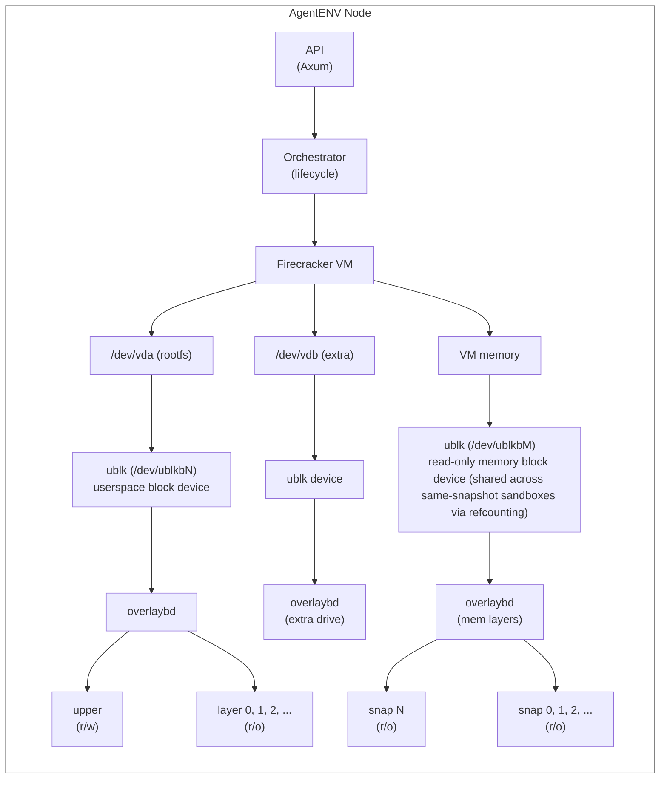
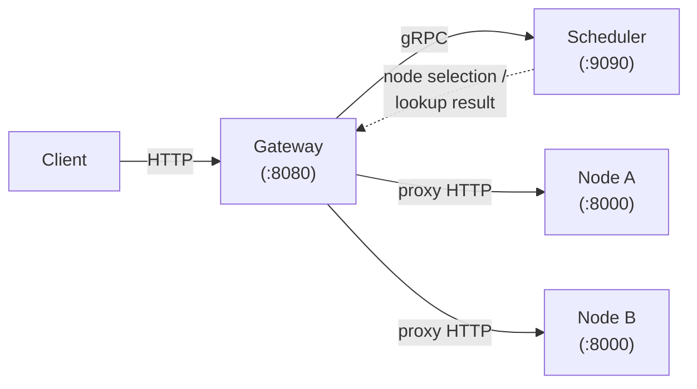

# AgentENV 架构

AgentENV 在隔离的、支持 Snapshot（快照）的 Firecracker microVM（微虚拟机）中运行 AI agent。其核心是一个**存储子系统**，它提供可挂载到 VM 的分层块设备，以及由 ublk 支撑的内存 Snapshot 恢复能力。系统还包含一个管理 Sandbox（沙盒）生命周期的单节点 **Orchestrator（编排器）**，以及一个用于多节点路由的**分布式控制平面**（Gateway（网关）+ Scheduler（调度器））。

## 系统概览



## 关键组件

| 组件 | 位置 | 职责 |
|---|---|---|
| **API Server** | `src/api/` | 暴露 E2B 兼容的 HTTP API 和反向代理端点。 |
| **Orchestrator** | `src/orchestrator/` | 协调 Sandbox 生命周期状态转换、持久化和清理。 |
| **Firecracker Runtime** | `src/sandbox/firecracker/` | 创建并控制每个 Sandbox 使用的 microVM。 |
| **Block Device Layer** | `storage/overlaybd/`、`storage/ublk/` | 提供分层 rootfs、挂载的驱动器以及由 Snapshot 支撑的块设备。 |
| **envd Integration** | `thirdparty/envd/`、`src/sandbox/` | 处理 guest 内的命令执行、文件操作、进程交互和健康上报。 |
| **Reverse Proxy** | `src/api/proxy.rs` | 将 HTTP、SSE 和 WebSocket 流量路由到 Sandbox 内的服务。 |
| **Snapshot Manager** | `src/snapshot/` | 提交、解析和删除持久化的 Sandbox Snapshot。 |
| **Template Builder** | `src/template/` | 构建面向用户的 Template（模板）并发布其已提交的 Snapshot。 |

## 存储

存储子系统将分层镜像文件转换为可被 VM 挂载的块设备，并为 Snapshot 恢复提供由 ublk 支撑的内存 Snapshot 恢复能力。共有四个 crate 组成这个活跃的子系统：

### overlaybd (`storage/overlaybd/`)

基于 LSMT（Log Structured Merge Tree，日志结构合并树）的分层镜像格式。

**镜像结构**：每个 layer 文件包含一个 `HeaderTrailer`（magic `LSMT\0\1\2`、UUID、flags、index/data offsets）以及一个 `DiskSegmentMapping` 条目数组（每个 16 字节，位打包：50-bit offset、14-bit length、55-bit physical offset、zeroed flag、layer tag）。layer 逐层堆叠：底部是不可变的压缩只读 layer，顶部是单个可写 upper layer。

**读取路径**：`ImageFile` 通过 segment 索引自上而下搜索各 layer 来解析读请求。第一个包含所请求块范围映射的 layer 负责提供数据。upper layer 中未映射的范围会向下层穿透。

**写入路径**：所有写入都追加到 upper layer。upper layer 的索引在内存中更新，并在 sync 时刷盘。

**Backend**（通过 `VirtualFile` trait 可插拔）：
- `LocalFile`：io_uring pread/pwrite，可选 O_DIRECT
- `registryfs_v2`：OCI registry（远程 layer 下载）
- `tar`：tar 归档读取
- 可选的 cache layer，用于缓存解压后的块

**压缩**：zstd（level 3），带有随机访问跳表和 CRC32C 校验和。

**Snapshot**：`ImageFile::create_snapshot_and_restack()` 是主要的暂停路径。它通过 `LSMTFile::close_seal_and_reopen()` 封存活跃的 upper layer，使 upper 成为最新的 lower layer，然后原地重新打开一个全新的可写 upper。`image/snapshot.rs::export_upper_as_snapshot_layer()` 保留了打包和导出流程使用的显式 upper 导出路径。

**关键文件**：`image/image_file.rs`（高层镜像）、`lsmt/file/`（LSMT 堆叠：`readonly.rs` 为 `LSMTReadOnlyFile`，`readwrite.rs` 为 `LSMTFile`，`stack.rs` 为 open/merge/stack 辅助函数）、`lsmt/format.rs`（二进制格式）、`lsmt/index.rs`（segment 映射）、`compression/zfile.rs`（压缩）、`image/snapshot.rs`。

### ublk (`storage/ublk/`)

使用 Linux ublk 内核驱动的异步用户态块设备服务器。将 OverlayBD 镜像暴露为 `/dev/ublkbN` 块设备。

**设备生命周期**：
1. `UVMUblkCtrlBuilder` 通过 io_uring `UringCmd` 向 `/dev/ublk-control` 发送 `ADD`
2. 内核分配设备 ID，创建 `/dev/ublkcN`（control）和 `/dev/ublkbN`（block）
3. 每个队列的 worker 线程启动，每个线程带有线程局部的 `AsyncIoRing` 和 slab 分配的 I/O slot
4. 内核将块 I/O 分发到 mmap 的 `ublksrv_io_desc` 数组；用户态异步处理它们
5. `delete_dev()` 拆除设备

**Target 实现**（`UVMUblkTarget` trait）：
- `OverlaybdTarget`：封装 `ImageFile` 以提供完整的分层镜像 I/O

**I/O 缓冲区**：`AutoRegBuffer`（通过稀疏 buffer 表实现零拷贝，kernel 6.8+）或 `UserBuffer`（传统分配）。

**关键文件**：`lib.rs`（公共 API）、`ctrl.rs`（设备控制器）、`dev.rs`（设备 + 队列管理）、`queue.rs`（I/O 描述符处理）、`io_buffer.rs`、`impls/overlaybd_target.rs`。

### ublk-daemon (`storage/ublk-daemon/`)

长期运行的守护进程（`uvm-ublk-daemon`），在单个进程中管理所有 ublk 设备，并通过 Unix 域套接字与 AgentENV 节点通信。

- 支持以下 RPC：为 Sandbox rootfs/extra 驱动器创建 OverlayBD runtime、为非 runtime 调用方创建 raw OverlayBD 设备、warm-pool 获取/释放、resize 能力查询、restack Snapshot、删除以及关闭。
- 所有远程镜像 I/O（OSS/registry 读取）都通过 `RuntimeDispatchFile`（`storage/overlaybd/src/io/dispatch_file.rs`）从各队列 runtime 派发到每个 `ImageService` 专用的 remote-io runtime，因为 opendal/reqwest 会将池化的 HTTP 连接任务固定到轮询它们的任意 runtime 上，而每设备 runtime 会在设备拆除时被丢弃；惰性构建的 remote runtime（file-cache worker、后台下载 Scheduler）同样在该专用 runtime 上构造并驱动，使其内部的 `tokio::spawn` 调用绑定在那里。当 overlaybd 全局配置设置 `remoteIoWorkers` > 0 时创建该 runtime（agentenv 生成的配置从 `ublk.overlaybd.remote_io_workers` 生成它，默认 4）；未设置或为零时，远程 I/O 在构造 `ImageService` 的 runtime 上运行。
- `UblkDaemonClient` 从节点 runtime 启动并监控守护进程。
- `UblkDeviceManager`（`src/sandbox/ublk/device.rs`）是面向节点的单例，将生命周期操作委托给 daemon client；设备 ID 在 daemon 中分配。

这种分离将 ublk 设备所有权和 io_uring 控制保持在专用进程中，同时由节点服务器编排生命周期状态。

### storage-util (`storage/util/`)

ublk 和 overlaybd 共用的 io_uring 抽象。

- `AsyncIoRing<S>`：通用异步 io_uring 封装，使用基于 slab 的 `RingFuture` 进行 CQE 投递。支持标准（64B）和扩展（128B）SQE 类型。
- `IoRingWorker`：生成带有线程局部 io_uring 实例的专用 worker 线程。MPSC 通道提交消除了跨线程锁。
- `ReloadableIDAllocator`：基于 bitmap 的 O(1) ID 分配/回收，带有空闲列表。支持在重启时重新加载已占用的 ID。

### Sandbox 集成（`src/sandbox/ublk/` + `src/sandbox/extra_drive.rs`）

- `device.rs`：拥有进程范围的 `UblkDeviceManager`，它与 `uvm-ublk-daemon` 通信并创建/删除/Snapshot 所有 runtime ublk 设备。
- `overlaybd.rs`：为 rootfs 和挂载的驱动器物化 runtime 配置（重写路径、创建指向 layer 文件的符号链接）。
- `extra_drive.rs`：准备用户指定的额外块驱动器，失败时回滚。只读和可写驱动器现在遵循相同的每-Sandbox 设备生命周期；唯一的语义差异是 overlaybd 是否物化可写 upper。

### 内存 Snapshot 恢复

内存 Snapshot 恢复使用由 ublk 支撑的 overlaybd 设备，而非 userfaultfd。恢复时，从堆叠的内存 overlaybd layer 创建一个只读 ublk 设备，并作为 `BackendType::File` 内存后端传递给 Firecracker。Firecracker 对块设备进行 mmap，并在首次写入时通过 COW 将页复制到匿名内存，因此底层设备永远不会被修改。

**共享**：多个从同一 Snapshot Template 启动的 Sandbox 通过引用计数共享单个内存 ublk 设备。这使得 Linux page cache 可在使用同一内存镜像的所有 Sandbox 之间复用，显著减少从同一 Template 并发启动时的 I/O。

**内存 Snapshot 创建**：暂停时，Firecracker 创建仅状态的 diff Snapshot。AgentENV 查询 Firecracker 的 dirty/present 内存范围，使用 `process_vm_readv` 读取选中的内存，并直接创建 OverlayBD 内存 layer。来自之前 Snapshot 的父 layer 被堆叠，形成完整的分层内存镜像。

> **注意**：`storage/uffd-core/` 包含一个基于 userfaultfd 的替代内存恢复实现，保留用于参考，但不包含在 workspace 构建中。

## 每节点子系统

每个节点都是 Linux 主机上的一个 AgentENV 服务器二进制（`src/bin/server.rs`），
具备 `/dev/kvm` 和一种已配置的虚拟化模式。KVM 是默认值；
PVM 目前需要 x86_64 和 `kvm_pvm` 主机模块。

| 子系统 | 位置 | 职责 |
|-----------|----------|---------------|
| API 层 | `src/api/` | Axum HTTP 服务器、OpenAPI 端点、到 Sandbox 服务的反向代理、节点/管理 API |
| Orchestrator | `src/orchestrator/` | Sandbox 生命周期状态机（Creating、Running、Pausing、Paused、Resuming、Killing）、自动驱逐、增量 runtime 指标、重启后暂停 Sandbox 的持久化 |
| 可观测性 | `src/observability/` | 节点身份、机器信息、请求时主机指标收集、用于管理 API 的节点 Snapshot 投影、可选的 Scheduler 心跳上报 |
| Sandbox | `src/sandbox/` | Firecracker VM 管理、网络命名空间、rootfs、envd 通信、ublk 设备（rootfs + memory）、warm 网络/块/Firecracker 池 |
| Snapshot + Template Builder | `src/snapshot/`、`src/template/` | `src/snapshot/` 拥有已提交 Snapshot 的存储/runtime 解析；`src/template/` 提供发布 Snapshot 的面向用户构建器 |
| P2P artifact 传输 | `src/p2p/` | 可选的跨项目 artifact 查找、发布和获取层，具备 disabled 和 iroh 支撑的传输实现 |
| 配置 | `src/cfg.rs` | Firecracker 路径、机器规格、超时、共享池调优、可观测性元数据、P2P 和 Scheduler 上报设置的 TOML 配置 |

### Sandbox 网络

网络子系统由进程范围的 `NetworkManager` 和每槽位 `Slot` 对象管理。命名空间拓扑、地址规划、数据包路径、防火墙顺序、egress 代理、策略替换、warm-pool 行为以及验证步骤，请参见 [Sandbox 网络架构](./networking.md)。

Snapshot 恢复还可以使用 `[pool.firecracker]` 预生成 `(network slot, Firecracker process)` 对。warm 条目将其网络槽位、进程和 Firecracker CWD 移交给恢复的 Sandbox，从而避免恢复关键路径中的进程生成和 API 套接字等待。`[pool.block]` 控制 ublk daemon 的 overlaybd warm 设备池；它共享相同的顶层水位线，但由于可复用块设备是镜像/大小特定的，它会从请求路径异步补充。

### 可观测性数据流

节点可观测性路径将请求时主机收集与请求时投影相结合：

- `src/orchestrator/metrics.rs` 在生命周期操作期间维护增量 runtime 计数器，包括运行中 Sandbox 数量、启动中 Sandbox 数量、已分配 CPU/内存以及创建成功/失败总数。
- `src/orchestrator/service.rs` 在生命周期状态变化影响节点 runtime 核算时，通过 `tokio::sync::watch` 通道发布这些计数器。
- `src/observability/identity.rs` 解析稳定的节点身份字段，如节点 ID、集群 ID、服务实例 ID、包版本和构建时 commit。
- `src/observability/machine.rs` 从 `/proc/cpuinfo` 捕获静态机器描述符。
- `src/observability/host.rs` 每次请求节点 Snapshot 时收集主机 CPU、内存和磁盘使用情况。CPU 百分比来自两次 `/proc/stat` 采样；首次请求时会以 100ms 窗口采集两次采样，以避免返回合成的零值。
- `src/observability/service.rs` 将最新的 Orchestrator 计数器、身份、机器信息、请求时主机指标和当前 Sandbox ID 名册合并为一个 `NodeSnapshot`，由管理端点返回，并被心跳上报复用。
- `src/observability/reporter.rs` 可选地通过 gRPC（`Heartbeat`）向 Scheduler 发送周期性心跳上报，并在关闭时尽力执行 `UnregisterNode`。
- Scheduler 上报配置可从 TOML（`[observability.scheduler_report]`）提供，并使用 `[cluster].scheduler_endpoint` 作为共享的 Scheduler 地址。reporter 启用标志、地址和间隔可由环境变量覆盖（`AENV_OBSERVABILITY_SCHEDULER_REPORT_ENABLED`、`AENV_OBSERVABILITY_SCHEDULER_ENDPOINT`、`AENV_OBSERVABILITY_REPORT_INTERVAL_SECS`）。
- 如果 P2P 传输暴露本地端点，reporter 会将其包含在 Scheduler 心跳中，以便其他节点可以发现它。

这使得节点请求在 Orchestrator 数据方面保持轻量：它们避免在每次 API 调用时重新列出和排序所有 Sandbox，同时仍返回新鲜的主机指标。

可观测性子系统有两个由配置控制的 scope：

- `observability.enabled`：控制是否构造节点可观测性服务。禁用时，节点/管理可观测性端点会降级，而不是尝试合成部分 Snapshot。
- `observability.scheduler_report.enabled`：控制可选的 Scheduler 心跳上报。可由 `AENV_OBSERVABILITY_SCHEDULER_REPORT_ENABLED` 覆盖。启用时，上报需要 `[cluster].scheduler_endpoint` 或 `AENV_OBSERVABILITY_SCHEDULER_ENDPOINT`。

### P2P Artifact 传输

`src/p2p/` 为需要在 runtime 节点之间交换已验证文件的模块提供跨项目的 artifact 传输抽象。使用方依赖 `P2pTransport` trait，其主要操作包括 `lookup`、`lookup_with_hints`、`fetch`、`publish`、`unpublish`、`local_endpoint` 和 `shutdown`。

默认的 `DisabledP2pTransport` 使该功能保持惰性：查找不返回任何描述符，publish 为空操作，fetch 以 `TransportDisabled` 失败。`IrohBlobsP2pTransport` 后端启动嵌入式 `iroh` 端点，通过 `iroh-blobs` 提供 artifact 字节，并在同一端点上提供一个小型 AgentENV 目录协议，将稳定的 artifact key 映射到与传输无关的描述符。

一个 P2P artifact key 代表一个逻辑 artifact。查找最多返回一个描述符，先从本地目录选择，然后按顺序从发现的 peer 中选择。artifact 描述符包含稳定 key、提供方节点 ID、可选的提供方端点、后端特定的 locator 字符串以及模块定义的 JSON 元数据。后端 locator 对调用方保持不透明；对于 iroh，locator 是用于内容寻址获取的 `iroh-blobs` 哈希。

成功的远程获取还会尽力从本地节点通告已获取的 blob。这使得获取节点成为后续 peer 的提供方，并让 artifact 在集群中扩散。

Peer 发现被解耦到 `P2pPeerDiscovery` 之后。在正常的多节点部署中，`SchedulerPeerDiscovery` 会周期性调用 Scheduler 的 `ListP2pPeers`，按后端和集群过滤，并排除本地节点。`StaticP2pPeerDiscovery` 和 `NoopP2pPeerDiscovery` 覆盖测试以及禁用/仅本地操作。

Snapshot 发布也使用 P2P 层作为尽力加速路径。Snapshot repository 提交成功后，`SnapshotManager` 会通告固定的 Firecracker artifact 和 overlaybd layer。对于固定 artifact，OSS 支撑的 Snapshot 解析会先尝试 P2P，再访问对象存储；POSIX 支撑的解析不使用 P2P，因为 POSIX repository 路径已经是已提交 artifact 的来源。Overlaybd layer 读取由 overlaybd P2P HTTP facade 加速，而非由 Snapshot resolver 加速。

详细设计请参见 [P2P Artifact 传输](./p2p-design.md)。

**节点 API 端点**（E2B 兼容）：

- `POST /sandboxes` 创建 Sandbox
- `GET /sandboxes` 列出 Sandbox
- `GET /sandboxes/{id}` 获取 Sandbox 元数据
- `DELETE /sandboxes/{id}` 删除 Sandbox
- `POST /sandboxes/{id}/pause` 暂停（Snapshot）一个 Sandbox
- `POST /sandboxes/{id}/resume` 从 Snapshot 恢复
- `GET /nodes` 返回节点级可观测性 Snapshot
- `GET /nodes/{id}` 返回节点详情及当前运行的 Sandbox
- `ANY /proxy`、`ANY /proxy/{path}`、路由头回退以及已配置的
 Sandbox 代理主机，反向代理到 Sandbox 服务

## 分布式控制平面

`services/` 中的多节点控制平面在多个 AgentENV 后端节点之间路由客户端流量。



**Gateway**（`services/gateway/`）：HTTP 反向代理。从头部（`x-agentenv-sandbox-id` / `e2b-sandbox-id`）或已配置的基于主机的代理域（`{port}-{sandboxID}.{domain}`）中提取 Sandbox 数据平面路由。基于主机的路由仅对显式的 `gateway.sandbox_proxy_domains` 条目启用，要求 Sandbox ID 符合 RFC 952/1123 DNS 标签兼容性，并要求完整的 `{port}-{sandboxID}` 标签符合 63 字符 DNS 标签限制。Runtime 节点有各自的 `[sandbox_proxy].domains` 设置以支持相同的主机基 URL 形态，并在 Sandbox 元数据中返回第一个配置的域。在多节点部署中，repository 辅助函数可将一个 `SANDBOX_PROXY_DOMAINS` 值同时应用到 Gateway 和 runtime 节点配置。Sandbox 控制平面路由（如 `/sandboxes/{id}/pause`）由 URL 路径中的 Sandbox ID 路由；Sandbox 数据平面流量不能仅从 URL 路径推断。对于新 Sandbox，调用 `Schedule()` 选择节点。对于现有 Sandbox，调用 `LookupNode()`。Sandbox 创建后，调用 `RecordAssignment()` 播种 Sandbox 到节点的绑定。在没有显式路由头的情况下，它还处理 `GET /sandboxes`、`GET /v2/sandboxes`、`GET /nodes` 的集群聚合，并在代理到解析出的节点之前通过 Scheduler 解析 `GET /nodes/{id}`。

**Scheduler**（`services/scheduler/`）：gRPC 服务，具有可插拔的节点发现和内存中的 Sandbox 到节点绑定，以及由 runtime 节点上报的已观测节点 Snapshot。RPC 包括 `Schedule`、`LookupNode`、`RecordAssignment`、`Heartbeat`、`ListObservedNodes`、`ListP2pPeers`、`GetNode` 和 `UnregisterNode`。策略：round_robin（默认）、random。Proto 契约：`services/api/proto/scheduler.proto`。对于 P2P，Scheduler 存储并返回来自心跳记录的不透明 peer 端点；artifact 目录查找和字节传输仍保持节点到节点。

绑定生命周期：

- `RecordAssignment` 在 Sandbox 创建成功后立即创建初始绑定。
- Runtime 心跳包含节点的完整 Sandbox ID 名册。Scheduler 将该名册视为该节点的真相来源，并移除最新心跳中缺失的绑定。
- `binding_ttl` 是路由信息的新鲜度 TTL，而非 Sandbox 超时的副本。如果绑定不再被 Gateway 或心跳刷新，Scheduler 会在下次查找或名册对账时将其丢弃。
- `UnregisterNode` 移除已观测节点记录，并主动清除该节点拥有的绑定。

发现模式：

- `static`：来自配置的显式 `scheduler.nodes` 列表
- `kubernetes`：对 headless `agentenv-nodes` Service 进行 EndpointSlice watch，使用就绪的 DaemonSet Pod IP 作为后端端点

**限制**：所有绑定都在内存中（Scheduler 重启时丢失）。Scheduler 重启后，绑定会从新的 Sandbox 创建以及每个 runtime 节点的下一次心跳名册重建。Kubernetes 发现会动态更新可调度节点集合，但绑定持久化仍未复制。

**部署**：

```bash
export AENV_API_KEY="e2b_$(openssl rand -hex 32)" # shared by local runtime and gateway processes
# local dev (single node)
make start-server && make -C services run-scheduler && make -C services run-gateway

# docker compose (multi-node; shared auth volume is provisioned automatically)
make deploy-up     # gateway + scheduler + 2 backend nodes
make deploy-down   # teardown

# kubernetes (gateway + scheduler + daemonset runtime nodes)
make k8s-render
make k8s-apply
```

在 Kubernetes 部署中，AgentENV runtime 节点以特权 DaemonSet 运行，
以便每台主机恰好获得一个 runtime Pod，并能访问 `/dev/kvm`、
执行 iptables/网络命名空间操作，以及使用由 hostPath 支撑的 workspace 缓存。
主机上的 runtime Pod 必须全部使用主机选定的 KVM/PVM 模式。
部署辅助工具在渲染/应用时从 `config/default.toml` 物化 DaemonSet ConfigMap，
使 AgentENV runtime 配置保持单一来源。

## 目录结构

```
storage/
├── overlaybd/src/              # layered image format (core)
│   ├── image/                  # high-level image abstraction
│   │   ├── image_file.rs       # ImageFile: reads/writes across the layer stack
│   │   ├── image_service.rs    # shared io_uring and image services
│   │   ├── helper.rs           # runtime upper preparation, path rewriting
│   │   └── snapshot.rs         # explicit upper export
│   ├── lsmt/                   # LSMT layer stacking
│   │   ├── file/               # LSMTReadOnlyFile, LSMTFile, stack helpers
│   │   ├── format.rs           # binary format (HeaderTrailer, DiskSegmentMapping)
│   │   └── index.rs            # segment mapping
│   ├── compression/zfile.rs    # zstd compression + jump tables
│   └── backend/                # pluggable VirtualFile backends
│       ├── local.rs            # LocalFile backend (io_uring)
│       ├── registryfs_v2.rs    # OCI registry backend
│       └── tar.rs              # tar archive backend
├── ublk/src/                   # userspace block device server
│   ├── lib.rs                  # public API
│   ├── ctrl.rs                 # /dev/ublk-control interface
│   ├── dev.rs                  # device + queue management
│   ├── queue.rs                # I/O descriptor handling
│   ├── io_buffer.rs            # zero-copy + traditional buffers
│   └── impls/                  # target implementations
│       └── overlaybd_target.rs # OverlaybdTarget
├── ublk-daemon/src/            # ublk daemon (unix socket RPC)
│   ├── client.rs               # daemon client used by node runtime
│   ├── server.rs               # daemon server + request loop
│   └── protocol.rs             # RPC message types
├── util/src/                   # shared io_uring abstractions
│   ├── io_ring/                # AsyncIoRing, IoRingWorker
│   └── id_allocator.rs         # bitmap-based ID allocation
└── uffd-core/src/              # userfaultfd memory restore (excluded from workspace, retained for reference)
    ├── handler.rs              # UffdHandle, page fault event loop
    ├── backend.rs              # MemoryImageBackend trait
    ├── overlaybd.rs            # OverlaybdMemoryImage backend
    ├── process_vm_reader.rs    # ProcessVmReader (process_vm_readv)
    └── scm.rs                  # SCM_RIGHTS fd passing

src/
├── bin/server.rs               # node binary entrypoint
├── api/                        # HTTP API layer
├── orchestrator/               # sandbox lifecycle
├── observability/              # node identity + host/runtime metrics projection
├── sandbox/                    # Firecracker VM management
│   ├── extra_drive.rs          # extra drive preparation
│   └── ublk/                   # storage integration
│       ├── device.rs           # daemon-backed ublk device lifecycle
│       └── overlaybd.rs        # runtime config materialization
├── snapshot/                   # committed snapshot model, repository backends, runtime resolution
├── template/                   # user-facing template builder over snapshots
└── cfg.rs                      # TOML config

services/                       # distributed control plane (Go)
├── gateway/                    # HTTP reverse proxy
├── scheduler/                  # gRPC node selection + binding
├── api/proto/                  # protobuf contracts
└── shared/                     # config, logging
```
