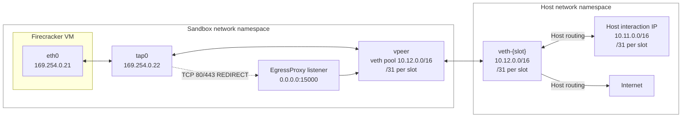
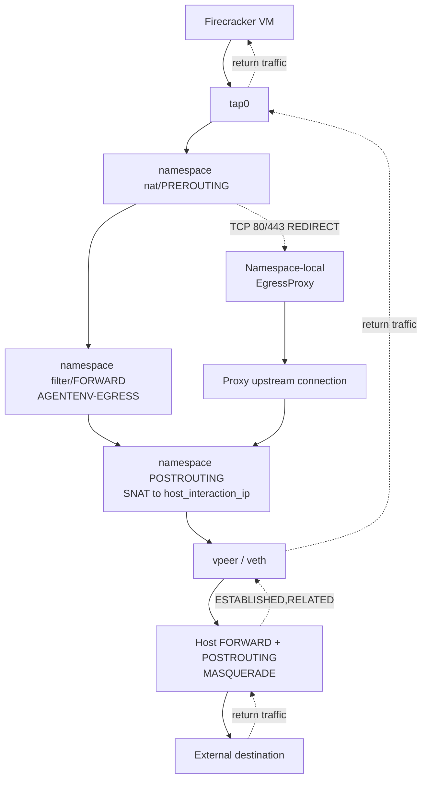

# Sandbox 网络架构

本文档描述单个 AgentENV 节点的网络数据平面。它涵盖 Firecracker Sandbox（沙盒）使用的 Linux 网络命名空间、主机和命名空间 iptables、runtime egress 策略更新，以及命名空间本地的 egress 代理。

面向用户的策略契约记录在公开的
[Sandboxes 网络文档](../concepts/sandboxes/networking.md)中。
本页解释该契约是如何实现的。

## 拓扑

每个运行中的 Sandbox 都有一个专用网络命名空间。Firecracker VM 通过 TAP 设备连接到该命名空间。命名空间通过 veth 对连接到主机；命名空间侧命名为 `vpeer`，主机侧命名为 `veth-{slot}`。



进程包含一个全局 `NetworkManager` 和一个全局 `EgressProxy` 注册表。该注册表在生命周期和策略记账方面是共享的，但每个使用由代理支撑策略的命名空间都有自己独立的监听套接字和监听线程。因此固定端口 `15000` 可以在各命名空间之间复用，而不会发生主机端口冲突。

## 所有权

| 所有者 | 源码 | 职责 |
| --- | --- | --- |
| `NetworkManager` | `src/sandbox/network/manager.rs` | 进程范围的槽位 bitmap、warm 池、全局主机 iptables、代理注册表、关闭 |
| `Slot` | `src/sandbox/network/slot.rs` | 单个命名空间、veth/TAP 设置、地址规划、命名空间 iptables、策略应用、清理 |
| 地址规划 | `src/sandbox/network/address_plan.rs` | 由槽位派生的 host interaction、veth 和 VM-link 地址以及内部拒绝范围 |
| 策略 | `src/sandbox/network/policy.rs` | API 归一化的 base/allow/deny 语义、绝对拒绝检查、代理拦截端口 |
| Egress 代理 | `src/sandbox/network/egress_proxy.rs` | 命名空间本地监听器、原始目标检查、Host/SNI 解析、中继、分阶段策略状态 |
| 主机解析器 | `src/sandbox/network/resolver.rs` | 进程范围的长期主机 netns DNS worker，用于可信域解析 |
| Firecracker 后端 | `src/sandbox/firecracker/sandbox.rs` | 分配/释放槽位，并在 VM 生命周期边界应用启动或更新后的策略 |
| Orchestrator/API | `src/orchestrator/`、`src/api/impls/sandbox.rs` | 验证请求、持久化策略、替换运行中 Sandbox 的策略 |

## 地址规划

`NetworkAddressPlan` 从 `[network.internal]` 派生地址，并从槽位索引分配它们：

- `host_interaction_ip`：从 `host_interaction_cidr` 为每个槽位分配一个地址。主机路由使用该地址通过命名空间访问 VM。
- `veth_host_ip` 和 `veth_vm_ip`：槽位 `/31` veth 链接的两个端点。主机端点分配给 `veth-{slot}`，命名空间端点分配给 `vpeer`。
- `vm_ip` 和 `tap_ip`：`vm_link_cidr` 上 VM 链接的固定端点。VM 获得 `vm_ip`；命名空间 TAP 接口获得 `tap_ip`。

命名空间通过 `veth_host_ip` 添加默认路由。Firecracker 接收一个 `ip=` 启动参数，其中包含 VM 地址、TAP 链接、netmask，以及从主机解析器配置中选择的 guest DNS 服务器。

冷启动还会追加 `sysctl.net.ipv4.conf.all.arp_notify=1`。guest NIC 没有配置 MAC，guest 用户态可能会在启动后更改它（例如 systemd-udevd 的 `MACAddressPolicy=persistent` 会重写随机启动 MAC）。使用 `arp_notify` 后，guest 内核会在每次变更时发送 gratuitous ARP，因此命名空间中 `tap0` 针对 `vm_ip` 的邻居条目会跟随新的 MAC，而不会变得陈旧。该参数在代码中追加，因此当 `firecracker.boot_args` 被覆盖时它也会生效。

完整的内部地址池会在用户 egress 规则之前被拒绝。这可以防止 Sandbox 访问另一个槽位的 host-interaction 地址、veth 链接或 VM 链接，即使用户策略另外允许该目标。

## 命名空间设置

`Slot::create_network()` 在专用线程上执行命名空间设置，因为网络命名空间成员资格是线程局部的：

1. 在已配置的 runtime `netns` 目录下创建并 bind-mount 一个持久化命名空间文件。
2. Unshare `CLONE_NEWNET`，设置严格的逆向路径过滤（`all` 和 `default` 的 `rp_filter=1`），而非继承主机的值，并创建 veth 对。
3. 将主机端点移动到进程的基线主机命名空间。
4. 配置 `lo`、`vpeer`、`tap0`、地址、链路状态和命名空间默认路由。
5. 启用命名空间 IPv4 转发并配置命名空间 NAT/filter 规则。
6. 配置主机 veth 地址和槽位 `host_interaction_ip` 的主机路由。

基线命名空间规则在设置期间安装一次。每-Sandbox 用户规则和代理重定向稍后由 `set_egress_policy()` 替换。

## 数据包路径



### Sandbox 发起的互联网流量

1. VM 通过 `eth0` 将数据包发送到 `tap0`。
2. 命名空间 NAT `PREROUTING` 链可能会将 TCP 端口 80 和 443 重定向到命名空间本地代理。
3. 继续作为路由流量传输的数据包从 `tap0` 到 `vpeer` 遍历 `filter/FORWARD`，进入 `AGENTENV-EGRESS`。
4. 命名空间 `POSTROUTING` 链将 VM 发起的流量 SNAT 到槽位的 `host_interaction_ip`。代理发起的上游连接会从命名空间 `vpeer` 地址 SNAT 到相同的槽位身份。
5. 主机 `FORWARD` 和 `POSTROUTING` 规则接受槽位源范围，并为其外部路由执行 MASQUERADE。

### 返回流量

返回数据包被分类为 `ESTABLISHED,RELATED`，并在命名空间中的用户 egress 链之前被接受。主机也接受返回到 `veth-{slot}` 的已建立流量。这在策略规则被替换时保留了主机/envd/代理响应和现有出站流。

### 主机到 VM 流量

主机侧的代理和 envd 流量以槽位的 `host_interaction_ip` 为目标。`vpeer` 上的命名空间 `PREROUTING` 将该地址 DNAT 到 VM 的固定 `vm_ip`。对应的返回路径由 established/related 规则接受。

## 主机防火墙

`NetworkManager` 为已配置的 host interaction CIDR 安装一组进程范围的主机规则。这些规则以对称方式插入/追加，并在 manager 关闭时移除：

```text
INPUT      -i veth-+ -s <host_interaction_cidr> -m conntrack --ctstate ESTABLISHED,RELATED -j ACCEPT
INPUT      -i veth-+ -s <host_interaction_cidr> -j REJECT
FORWARD    -i veth-+ -s <host_interaction_cidr> -j ACCEPT
FORWARD    -o veth-+ -d <host_interaction_cidr> --state ESTABLISHED,RELATED -j ACCEPT
POSTROUTING -s <host_interaction_cidr> -j MASQUERADE
```

`INPUT` 对阻止 guest 发起的新连接到达任意主机服务，同时保留已建立的主机发起流量。`FORWARD` 和 `MASQUERADE` 规则处理命名空间 SNAT 之后命名空间到互联网的转发。

## 命名空间防火墙

`tap0` 上源地址不是 VM 分配地址的 guest 数据包会在 `raw/PREROUTING` 中被丢弃，此时路由或 NAT 尚未发生。否则，伪造的源地址会绕过命名空间 SNAT 并原样离开节点；严格的逆向路径过滤是同一检查的第二层。

每个命名空间有三个受管理的链：

- `AGENTENV-EGRESS` 是从 guest 流量的 `FORWARD` 到达的静态链。
- `AGENTENV-USER-EGRESS` 包含可替换的用户策略。
- `AGENTENV-EGRESS-PROXY` 是从代理支撑流量的 `nat/PREROUTING` 到达的可替换 NAT 链。

静态 filter 链的顺序如下：

1. 接受从 `tap0` 到 `vpeer` 的 `ESTABLISHED,RELATED` 流量。
2. 允许到已配置 guest DNS 地址端口 53 的 UDP/TCP DNS 流量。
3. 拒绝完整的内部地址池和已配置的 `always_denied_cidrs`。
4. 跳转到 `AGENTENV-USER-EGRESS`。

用户链按此顺序渲染：

1. 显式 `allowOut` CIDR/IP 规则（`ACCEPT`）。
2. 显式 `denyOut` CIDR/IP 规则（`REJECT`）。
3. 当基础策略为 `Deny` 时的 `0.0.0.0/0` 拒绝规则。

这种排序使用户 allow 规则优先于重叠的用户 deny，而静态内部/平台拒绝仍然不可覆盖。

## Egress 代理

egress 代理是命名空间本地且透明的。它不终止 TLS，也不重写 HTTP。需要代理中介的策略仅将该命名空间内的 TCP 端口 80 和 443 重定向到 `0.0.0.0:15000`。

### 连接流程

1. `EgressProxy::ensure_listener()` 使用 `setns` 进入目标命名空间，绑定监听器，并启动非阻塞 accept 循环。
2. 监听器接受一个连接并复制该连接的活动策略。
3. 连接处理器读取 `SO_ORIGINAL_DST`，以恢复被 `REDIRECT` 修改的目标。
4. 它会缓冲初始请求/握手最多 64 KiB，并提取 HTTP `Host` 或 TLS ClientHello SNI。TLS 握手字节会跨记录边界累积。
5. 域名匹配会发送到进程范围解析器 worker，该 worker 仍留在主机网络命名空间中。每个候选 IPv4 地址都会通过 `SandboxNetworkPolicy::is_domain_allowed` 检查，包括绝对平台和内部范围拒绝，然后才会被选中。
6. 域名连接会拨号到选中的可信地址。IP/CIDR 连接在 `is_ip_allowed` 之后使用原始目标。
7. 缓冲的 prelude 会写入上游，两个方向都以 half-close 处理进行中继。

当存在域名 allowlist 时，空或无法识别的主机名不能回退到基础 allow 策略。这使域名策略保持 fail-closed。域名 allow 规则要求 API 请求包含显式的 `denyOut: ["0.0.0.0/0"]`。

### 策略替换

运行中策略更新是一项替换操作：

1. 将新策略暂存到代理的 `pending` map 中。
2. 当需要代理中介时，确保命名空间监听器存在。
3. 将 filter 和 NAT 链替换作为一个 `iptables-restore` 批次应用。
4. 当已存在活动的代理策略时，仅在命名空间批次成功后激活待处理策略。
5. 当为一个尚无活动代理策略的命名空间启用代理中介时，在安装重定向之前激活已准备好的策略。这会在原子 iptables 批次完成之前保留命名空间之前的默认允许行为；在该批次成功之前，任何连接都不能通过 `REDIRECT` 到达监听器。
6. 如果活动代理策略存在时更新失败，则丢弃待处理策略并保留之前的活动策略。

每个已接受的连接都持有在 accept 时选择的活动策略副本。因此更新主要影响新连接；现有中继不会被主动终止。移除策略或槽位会关闭被跟踪的处理程序套接字，并在移除命名空间资源之前 join 其线程。

### 命名空间所有权

进程全局注册表以 `host_interaction_ip` 为键，但监听器不会在命名空间之间共享。每个命名空间都有自己的监听线程和套接字。当策略不再需要代理中介时，监听器以及活动/待处理策略会被移除。完整槽位清理会在删除 veth 和卸载命名空间之前停止监听器。

## 生命周期与 Warm 池

`NetworkManager::allocate_any()` 首先获取一个 warm `Slot`。如果没有可用的，它会分配一个新的槽位索引并创建命名空间/veth/TAP 资源。随后 Firecracker 后端在启动或恢复继续之前应用启动策略。

停止时，槽位可能返回 warm 池。命名空间和基线网络保持可用以供复用；`user_egress_rules_present` 跟踪下一个租户是否需要用户链替换。下一次策略应用会清除或替换陈旧用户规则，并酌情移除陈旧代理策略。从池中排空的槽位会被完全清理。

关闭时，manager 停止池维护、排空 warm 槽位、停止所有代理监听器、移除全局主机规则，并移除命名空间/veth 状态。`atexit` 钩子和 `Drop` 路径为异常退出提供尽力清理。
