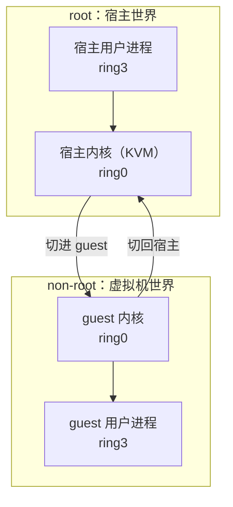
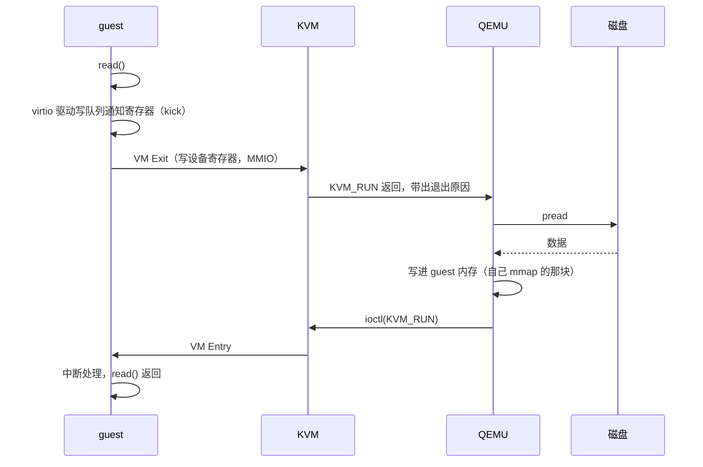

# CPU 工作模式：宿主与虚拟机

> [!abstract] 一句话
> 虚拟机可以跑得接近原生速度，却碰不到宿主的任何一页内存，因为 CPU 在 ring 之外又多切了一层“世界”。

> [!question] 读完能回答
> - ring 为什么挡不住 guest 里的内核？
> - 两个世界怎么来回切换？
> - guest 以为的“物理内存”到底是什么？

## 0. 先认识几个词

- **虚拟机（VM）** 是一台由软件模拟出来的计算机，里面可以装完整的操作系统。
- **KVM** 是内核态的虚拟化核心，负责把 CPU 和内存借给虚拟机，并在它越界时收回控制权。
- **VMM** 是用户态的虚拟机管理程序，负责模拟设备、装载系统、创建和销毁虚拟机。QEMU、Firecracker 都属于这一类。
- **guest** 指虚拟机本身，**host** 指运行 KVM 和 VMM 的那台真机。
- **vCPU** 是虚拟机里看到的一颗 CPU。它并不是从物理核上切下来的一块，通常对应宿主上的一个线程（线程视角见 [[vCPU 与线程]]）。
- **ring** 是 CPU 的权限等级，编号 0～3，数字越小权限越大。现代 OS 只用 ring0 给内核、ring3 给用户程序。

要注意的是，KVM 与 VMM 是并列的两半，不是上下级：前者管 CPU 和内存，后者管设备和生命周期，中间用 `ioctl` 这类接口对接（细节见 [[KVM 的接口层]]）。

CPU 执行特权指令、或者访问受保护的内存和段时，会拿当前所在的等级（CPL）和这条操作要求的等级比较，不够就触发异常。这是后面所有讨论的基础。

## 1. 为什么需要两个世界

问题出在 guest 内核身上：它也是 ring0。

内核要管页表、中断和设备，这些工作在真机上都要求 ring0，虚拟化不能把它降成 ring3，否则 guest 连启动都做不到。

可一旦真的让它跑在 ring0，它就会闯祸：

- 它执行 `hlt`，物理核就真的睡下去了。
- 它改 `CR3`，改的是宿主的页表基址。
- 它关中断，影响的是整台物理机。

==ring 检查防的是用户态，防不了另一个内核。==

读到这里会冒出一个自然的想法：那就再加一级权限，比如叫 ring -1，把 guest 内核关进去不就行了？

硬件干的其实正是这件事，只是它没把这级算进 ring 编号。这一级不是“权限更高”，而是“另一个坐标系”：同样是 ring0，在宿主里意味着能碰整台机器，在虚拟机里只意味着能碰这台虚拟机。权限还是原来那些，换掉的只是边界。

于是执行环境被分成两个平行的世界，每个世界里都有完整的 ring0～3：

| 世界 | 住在这里的 |
|---|---|
| **root**（宿主世界） | 宿主内核（含 KVM） |
| **non-root**（虚拟机世界） | guest 内核、guest 进程 |

图的上面是宿主，下面是虚拟机。两条跨世界的箭头就是下一节要讲的切换，而每个世界内部仍然分用户态和内核态。

**关键点**：guest 的 ring0 只在 non-root 里有效，出了这个世界的门就不作数。而且控制这一切的开关它读不到也改不了，所以它始终不知道自己不在 root 里。

## 2. 怎么切换

两个世界分开了，可 CPU 一次只能跑一条指令流。guest 全速跑的时候，宿主就停在那儿，也没有人盯着 guest 在干什么——每一条都拦下来看一眼，比解释执行还慢。

所以不能靠“看着它跑”，只能提前约好哪些事必须停下来报告。这张报备清单不是 guest 自己定的，而是 KVM 提前配置好的，比如设备 I/O、访问还没映射的地址和某些指令。

guest 碰到清单上的事时，CPU 会停下它、保存现场并跳回宿主，这个动作叫 **VM Exit**。

宿主处理完之后，再恢复现场、回到 guest 继续执行，这个动作叫 **VM Entry**。

Exit 时硬件把 guest 的状态存起来、把宿主的状态装回去，Entry 做的正好相反。KVM 在 Exit 之后会读退出原因，决定是自己补上一页、把设备访问转给 QEMU，还是直接返回 guest。

下面这些事会让 CPU 切回来：

- guest 执行了被拦截的指令，比如 `hlt`、`cpuid`，或访问端口的 `in`/`out`。
- guest 访问的页还没有映射到真内存。
- 外部中断到了，而它被配置成先交给宿主。
- guest 执行 `VMCALL`，主动请宿主替它做一件事，这个动作叫 **hypercall**。
- guest 触发了三层异常都没人接的情况，也就是 triple fault，相当于内核崩了。

可以拿系统调用做锚点：两者都是“交出控制权、做完再拿回来”。区别在范围——系统调用换的是 ring，是同一个世界里的纵向切换；VM Exit 换的是世界，还要把整套 CPU 状态换掉，代价通常再贵一到两个数量级。

> [!warning] 别被名字骗了
> VM Exit 不是“虚拟机关机”，它只是“这一次把 CPU 交还宿主”，处理完还会 Entry 回去。一台虚拟机一秒可能 Exit 上万次。

> [!note]- 展开：怎么开启
> Intel 把这套扩展叫 VMX，AMD 叫 SVM。开启顺序是先把 `CR4.VMXE` 置 1 允许使用虚拟化指令，再对每个逻辑核各执行一次 `VMXON` 让它进入 root 模式，最后用 `VMLAUNCH` 或 `VMRESUME` 进入 guest。

## 3. 状态存哪

**问题**：切换一次要换掉整套寄存器。如果让软件一个字段一个字段地保存，光寄存器就得几十条指令，而且每次进出都要来一遍。

**办法**：在内存里放一块硬件认得的固定格式区域，切换时由 CPU 自己批量读写，这块区域叫 **VMCS**。一个 vCPU 一份，CPU 只保存一个指向它的指针。

| 区域 | 内容 |
|---|---|
| guest-state | guest 的寄存器、页表基址和段 |
| host-state | 宿主对应的同一套状态 |
| 拦截规则 | 哪些动作要触发 Exit：有的是单独一位开关，有的是 bitmap（某位为 1 就拦截） |
| 退出信息 | 这次为什么退出、退出时的地址和错误码 |

前两块存的是两边的状态，后两块存的是规则和这次的退出原因。上一节说的那张“报备清单”，就是这四块里的第三块。

**为什么快**：两套状态分开存放，硬件换班时可以批量读写，不用软件逐字段 `push`/`pop`。

> 可以这样类比：VMCS 是一份交接班记录本，两班人的东西各占一格。

## 4. 内存怎么隔离

guest 内核要管理“物理内存”，可如果直接把真实物理地址交给它，它就能读写宿主的任何一页。

办法是在中间再垫一层翻译：

guest 的页表把虚拟地址翻译成 **guest 物理地址（GPA）**，这是一层假地址。硬件再往下翻一次，把 GPA 变成 **宿主物理地址（HPA）**，这才是内存条上的真实位置。负责第二层翻译的页表由 KVM 维护，叫 **EPT**（AMD 叫 NPT）。

举个具体地址就清楚了。guest 里的程序访问 `0x7f3a_0000`，guest 页表把它翻成 GPA `0x1000`；而这片内存实际被放在宿主的 `0x8000_0000` 往后，EPT 再把 `0x1000` 翻成 `0x8000_1000`。

| guest 虚拟地址 | guest 物理地址（GPA） | 宿主物理地址（HPA） |
|---|---|---|
| `0x7f3a_0000` | `0x1000` | `0x8000_1000` |

guest 只在前两列里打转，第三列它永远看不到。

为什么非要两层？原因有两个。

- 第一层翻出来的 GPA 只是这台虚拟机的“内部坐标”，物理内存根本不认识它。
- 更关键的是，guest 的页表由它自己写，想指哪就指哪。KVM 没法逐条检查，只能在它下面压一层自己控制的翻译，把 GPA 关进分配给这台虚拟机的物理页里。

EPT 还带来一个后果：GPA 没有映射时会触发 EPT violation，进而 VM Exit，KVM 通常在内核里直接补上映射，不去打扰 QEMU。

这层翻译替代掉的是更早的做法：KVM 自己维护一套“影子页表”，替 guest 合成一套真页表，guest 每改一次页表就要软件同步一遍，代价极高。硬件把这件活接过去，才有了“接近原生”的可能。

> 可以这样类比：住客只知道自己的“301 房”，前台那张表才记着 301 到底在哪栋楼。

## 5. guest 的 ring0 缺了什么

guest 内核虽然 CPL=0，但它跑在 non-root，所以前面列过的那几类拦截对它一样生效。差别只在拦下来之后怎么处理——有的直接报错，有的由宿主代劳。

- 虚拟化指令（`VMXON`、`VMLAUNCH`、`VMREAD`）报的是非法指令异常（`#UD`），不是 Exit。宿主干脆不让它知道自己有这种能力，否则它就能在里头再造一台虚拟机。
- `CR0`/`CR4` 的某些位、以及被 MSR bitmap 拦住的 MSR 会触发 Exit；这些状态归宿主所有，KVM 可能放行，也可能屏蔽掉它不该动的位。
- 装载自己的中断描述符表（IDT）时如果开了对应控制，同样会触发 Exit——宿主得知道它把异常入口指到了哪。

这不是 ring 不够高，而是世界不对——同样一条指令放到 root 里就允许。

反过来也要记住：**绝大多数指令它是原生跑的**。加减乘除、访存、改自己的页表、执行 `INVLPG`，都不会触发 Exit。拦的只是那些“会影响整个世界”的动作。

把两个维度合起来看：

| | ring0 | ring3 |
|---|---|---|
| **root** | 宿主内核（含 KVM） | 宿主进程 |
| **non-root** | guest 内核 | guest 进程 |

root/non-root 选的是世界，ring 选的是权限，两者不能互相替代。

最容易混的一点：**root 不等于 ring0**。宿主的普通进程也在 root 里，只是 ring3。平时听到的“ring -1”并不存在，它指的就是 root。

## 6. 一次 I/O 往返

以 guest 读磁盘为例，可以看到一次 Exit 和 Entry 在真实路径里是怎么发生的。

virtio 设备把几个寄存器暴露在 guest 的地址空间里，guest 写它们时和写普通内存没有区别，这种访问方式叫 **MMIO**。可那段地址不在 guest 的 RAM 范围里，EPT 里没有对应的页，硬件于是触发一次 MMIO Exit。

KVM 一查地址不属于 RAM，就不会像缺页那样自己补页，而是结束这次 `KVM_RUN`，把控制权还给用户态的 VMM。QEMU 从返回值里读到退出原因，读盘之后把数据写进自己 mmap 的那块 guest 内存，再调一次 `KVM_RUN`，让 guest 接着跑，KVM 顺手注入一个中断。

整条路径里，只有 KVM 处理 Exit、QEMU 读盘写回、再 Entry 这几步需要宿主介入，其余都在 non-root 原生执行。设备前后端的分工见 [[virtio-blk 前后端]]。

## 7. 性能

> [!tip] 一条公式
> 性能损失 ≈ Exit 次数 × 单次开销

单次开销和频率一起放大成本：一次几微秒，一秒上万次就是几十毫秒。

- 每次 Exit 都很贵，因为它要保存和恢复整套状态，还会污染缓存和 TLB。
- 设备 I/O 默认每次都要绕到 QEMU，是最常见的一类 Exit。
- 中断如果每个都走一次 Exit，开销会盖过中断本身。
- EPT 里还没映射的页，第一次访问也要 Exit 一次，进程刚启动时最密集。

优化无非两个方向：少 Exit，或者让每次 Exit 更短。

- **少 Exit**：virtio 用描述符环把一次 I/O 压成一次通知，而不是每个字节都陷出去；APICv 和 posted interrupt 则让中断直接投递进 guest。
- **让每次 Exit 更短**：ioeventfd 让 KVM 直接处理通知，不必回到 QEMU 用户态；vhost 把数据路径搬进宿主内核；缺页由 KVM 在内核里补 EPT 映射。

## 8. 总结

- CPU 把执行环境分成两个世界：root 归宿主，non-root 归虚拟机。
- 整套机制只有三个关键点：Entry/Exit 负责切换，VMCS 存放两边状态和拦截规则，EPT 隔离内存。
- 一条规律贯穿始终：Exit 越少、每次越短，虚拟机越接近原生。

---

## 附录 A：三家对照

| | Intel | AMD | ARM |
|---|---|---|---|
| 宿主 | VMX root | host mode | EL1 内核 + EL2 虚拟化 |
| 虚拟机 | VMX non-root | guest mode | EL0 + EL1 |
| 状态档案 | VMCS | VMCB | 系统寄存器 |
| 进入 | `VMLAUNCH` | `VMRUN` | `eret` |
| 退出 | VM Exit | `#VMEXIT` | 异常到 EL2 |

ARM 不做“ring + 世界”两套坐标，而是把它们合成一套异常等级：EL0 用户、EL1 内核、EL2 虚拟化、EL3 固件。

## 附录 B：KVM 与 QEMU 的分工

一台虚拟机能跑起来，靠的是内核态和用户态两层配合：

| | KVM（内核态） | QEMU（用户态） |
|---|---|---|
| 负责 | 建 vCPU、维护 VMCS 和 EPT、执行 Entry、处理 Exit | 分配 guest 内存、模拟设备、处理需要用户态介入的 Exit、装载和销毁虚拟机 |
| 不碰 | 设备模型、磁盘镜像 | 硬件特权操作 |

两边靠一组 ioctl 对接：QEMU 用 `KVM_CREATE_VM` 建虚拟机，用 `KVM_RUN` 让 vCPU 跑起来，Exit 之后读退出原因再决定下一步。Firecracker 是这一层的另一个实现，设备模型精简到只剩 virtio 块/网卡和串口，启动路径更短（调用链见 [[指令派发完整链路（从零开始）]]）。

有的资料把这两半合起来统称为一整套虚拟化层，本文始终分开叫。因为“谁碰硬件、谁管设备”这条线一糊，后面看 Exit 路径就会绕。真正碰硬件的是 KVM，QEMU 只是替它招呼设备，两半合起来才是一套能跑的栈。
