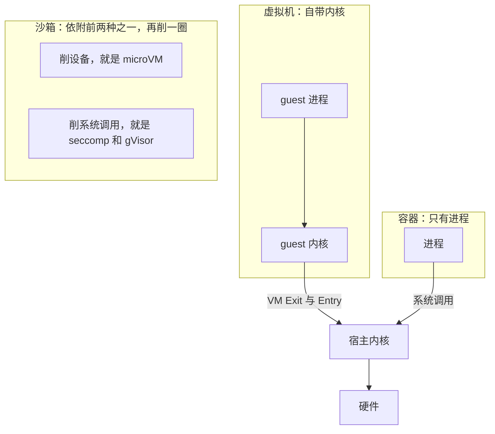

> [!abstract] 一句话
> 三者不是三种并列的技术，而是把隔离的墙砌在不同高度的三个位置。

## 0. 墙砌在哪一层

隔离的本质是“里面的东西碰不到外面”。三者的区别在于隔离单元里装了什么：

虚拟机里多一个内核，跨出去要切世界；容器里只有进程，系统调用直接落到宿主内核。沙箱没有自己的形状：削设备的那一种（microVM）本来就是虚拟机，削系统调用的那一种（seccomp、gVisor）本来就是容器，区别只在允许它碰多少东西。

## 1. 虚拟机：墙在硬件

guest 里有自己的内核，它以为自己在管 CPU、页表、设备，实际上这些都由宿主那侧代劳。因为内核是自己的，里面进程的系统调用也在墙内完成，碰不到宿主内核。

代价有两样：每次跨墙要切换世界，而且整套系统要各自启动一遍。见 [[CPU 工作模式]]。

## 2. 容器：墙在系统调用

容器里没有第二个内核，进程直接调用宿主内核。所谓隔离，是内核给这组进程换了一套视图：自己的 PID、挂载点、网络栈，外加资源上限和权限裁剪。

好处是启动只要毫秒级，密度也高；坏处是墙薄，内核的漏洞就是墙的漏洞。共享内核还带来一个限制：容器里跑不了和宿主不同版本的内核。

## 3. 沙箱：一个没有统一定义的词

“沙箱”通常不指某种具体技术，而是指在已有隔离之上，再把能碰到的东西砍掉一圈。砍法不同，强度也不同：

| 做法 | 砍掉什么 | 例子 |
|---|---|---|
| 收紧容器 | 多余的权限和系统调用 | seccomp 白名单、只读根文件系统、去掉 capability |
| 换掉内核 | 系统调用不再由宿主内核直接处理 | gVisor，把系统调用交给用户态实现 |
| 换回硬件 | 只保留最少的设备 | Firecracker 的 microVM |
| 不给系统调用 | 能力全靠宿主显式提供 | WASM 运行时 |

所以“沙箱算虚拟机还是容器”这个问题没有意义，得看它具体砍在哪一层。

## 4. 一张对照表

| | 虚拟机 | 容器 | 沙箱 |
|---|---|---|---|
| 墙砌在哪 | 硬件接口 | 系统调用接口 | 视实现，通常比容器再收一层 |
| 自带内核 | 有 | 没有 | microVM 有，gVisor 是用户态内核，WASM 没有 |
| 启动时间 | 百毫秒起 | 毫秒 | 毫秒到百毫秒 |
| 主要成本 | 世界切换，加上每台一份内核 | 几乎没有 | 兼容性和性能 |
| 典型实现 | KVM 加 QEMU | Docker、containerd | Firecracker、gVisor、WASM 运行时 |

## 5. 怎么选

按顺序问三个问题：

1. 里面要不要跑和宿主不同的内核？要，就只能用虚拟机或 microVM。
2. 能不能接受“宿主内核的漏洞等于被突破”？不能，就往沙箱那一侧挪。
3. 启动时间和密度要求多高？要毫秒级、一台机器上跑几百个，容器更合适。

真实系统常常混着用：节点上跑容器，多租户的代码执行用 microVM，两层同时存在。

## 6. 和前面几篇的关系

虚拟机内部怎么运作，见 [[虚拟化在做什么]] 和 [[CPU 工作模式]]。Firecracker 为什么能把启动压到百毫秒，看 [[一台虚拟机的生命周期]] 里创建那一步，以及 [[指令派发完整链路（从零开始）]]。
