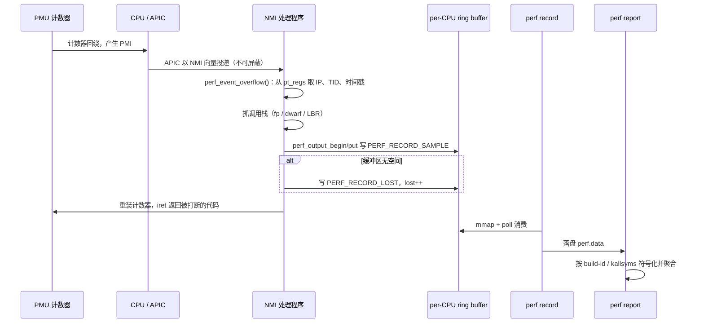

> [!abstract] 一句话
> perf 采样是**基于硬件事件的中断采样**：PMU 计数器每溢出一次就产生一个 PMI（x86 上以 NMI 投递），内核在中断上下文里抓下 IP、调用栈等现场写入 per-CPU 环形缓冲区；用户态再把样本符号化、聚合。按 `cycles` 采样时，样本占比近似时间占比。

## 1. 两种模式：计数 vs 采样

| 模式 | 命令 | 是否产生中断 | 结果 |
|---|---|---|---|
| 计数 | `perf stat` | 否（默认只在开始/结束时读） | 事件总量，精确（多路复用时为折算值），无代码归属 |
| 采样 | `perf record` | **是，每个采样点一次中断** | 样本分布，有归属，统计近似 |

采样不是"定时器轮询"，而是"计数器数到阈值 → 硬件中断"。这一点决定了它的精度、开销和丢样本方式。

## 2. 一次采样的完整路径

### 2.1 配置：事件、阈值、抓什么

`perf_event_open()` 创建事件时，**调用方（perf 工具）在 `perf_event_attr` 里填好三件事，内核负责校验并翻译成硬件配置**：

| 问题        | 属性                                                          | 命令行                 |
| --------- | ----------------------------------------------------------- | ------------------- |
| 数哪个事件？    | `type` + `config`（如硬件事件 `cycles`）                           | `-e cycles`         |
| 数多少个打断一次？ | `sample_period`（按个数）或 `sample_freq`（按时间）                    | `-c N` / `-F F`     |
| 打断时抓什么？   | `sample_type` 位掩码（IP / TID / TIME / CALLCHAIN / ADDR / BRANCH_STACK） | `-g`、`perf mem`、`-b` |

**period 是"两次采样之间隔了多少个事件"**，也就是写进硬件计数器的初值（`sample_period`）。它出现在这里，是因为计数器只会"数满就中断"，不认识"每秒几次"：

- `-c N`：直接把 period 设为 N
- `-F F`：先测事件发生速率，再折算 $period \approx 事件速率 / F$，之后每次中断用实测值修正

| 写法 | 含义 |
| --- | --- |
| `-e <事件> -c N` | 该事件每发生 N 次采一次样 |
| `-e <事件> -F F` | 该事件每秒采 F 个样本 |

**period 怎么用**：计数器是个 64 位"倒数计时器"。内核写入 $2^{64}-N$，每发生一个事件加 1，加满 N 次回绕到 0，溢出位置位 → 发中断；中断里再把 $2^{64}-N$ 写回去，开始下一轮。

**换算关系与边界**：

- 用 `-F` 时，实际采样率 ≈ min(目标 F, 事件发生速率, `max_sample_rate`)。例：`-F 999` 在 3 GHz 的 `cycles` 上 period ≈ 300 万周期；在每秒 200 次的 `cache-misses` 上 period 只能取 1，实际 200 次/秒
- **事件稀疏时 `-F` 会落空**：period 被压到下限 1（每个事件都采），也凑不够 F——`-F` 只是上限，不是保证
- **事件密集时 `-F` 靠拉大 period 达标**；仍超限就被内核 throttle
- 多个 `-e` 各自独立换算；`-F 999` 是每个事件各 999 次/秒

**sample_type：决定一条样本带什么**

`sample_type` 是事件属性里的位掩码，决定每个样本记录哪些字段。平时不用直接写它，用命令行开关间接设置：

| 开关 | 带上什么 | 用途 |
|---|---|---|
| `-g` | 调用栈 | 看热点由谁调用 |
| `--call-graph dwarf` | 用户栈原始数据 | 帧指针不可用时的精确栈 |
| `perf mem record` | 数据地址、来源层级 | 分析访存 |
| `-b` | 分支记录（LBR） | 分析分支 |
| `-W` | 采样权重 | 按延迟等加权 |

`--call-graph` 有三种方式：

- `fp`（默认）：沿帧指针链回溯。最便宜，但需要程序保留帧指针（`-fno-omit-frame-pointer`），否则栈会断。
- `dwarf`：把用户栈拷出来，在用户态用调试信息展开。不依赖帧指针，最准，也最贵（默认每样本 8 KB）。
- `lbr`：用 CPU 的 Last Branch Record 硬件记录最近的分支。开销低，但深度有限（通常十几层）。

默认只带 IP、TID、时间、CPU、period 这类小字段，开销最低。开的字段越多，每条记录越大，ring buffer 填得越快，越容易丢样本——**只开当前分析需要的**。

> [!warning] 事件类型决定了百分比的口径
> `perf report` 里的百分比是**样本占比**，而样本来自哪个事件，就代表哪种加权：
> - `cycles` → 周期占比，最接近"时间花在哪"
> - `instructions` → 指令数占比，回答"哪段代码执行得多"
> - `cache-misses` → miss 发生的分布，只能说明"miss 在哪"，不能当耗时占比

### 2.2 溢出 → PMI → NMI

（PMI、NMI、IP 等术语的含义见文末术语表。）



几个容易忽略的点：

- APIC 的 LVTPC 可配置为**普通中断或 NMI**；Linux 默认走 NMI，因为 NMI 不受 `cli` 影响，能覆盖关中断的内核路径
- 唤醒 ring buffer 的读者不能在 NMI 里直接 `wake_up()`（可能死锁），所以通过 `irq_work` 延迟到安全上下文
- 软件事件（`cpu-clock`）没有 PMI，改用 **hrtimer 中断** 定时触发

### 2.3 中断上下文的硬约束

| 约束 | 原因 | 设计后果 |
|---|---|---|
| 不可睡眠、不可持锁、不可缺页 | NMI 可能在任意上下文（含持锁、关中断）打断 | 中断里只做定长拷贝，符号解析推迟到用户态 |
| NMI 处理期间 NMI 被屏蔽 | x86 NMI 不支持嵌套 | 该窗口内的溢出丢失，计入 lost |
| 处理时间必须极短 | 否则拖慢整机，形成采样开销 | 采样率有上限，内核会限流 |
| 缓冲区是 per-CPU 单生产者 | 避免跨 CPU 锁 | 满则丢，且只能丢弃不能阻塞 |

### 2.4 返回与限流

处理完重装计数器并 `iret`。内核的 `perf_event_account_interrupt()` 统计中断速率，超过 `/proc/sys/kernel/perf_event_max_sample_rate` 就触发 throttle（拉长 period、必要时暂时关闭事件），`dmesg` 会打印：

```
perf: interrupt took too long (2507 > 2500), lowering kernel.perf_event_max_sample_rate to 50000
```

## 3. 精度：skid 与 PEBS

- 中断只在**指令边界**被接受，保存的是下一条待执行指令的 IP；从计数器溢出到 handler 读取 `pt_regs->ip` 之间又隔了若干流水线周期 → 样本 IP 落在触发溢出的指令之后，即 **skid**
- skid 是中断采样的固有属性，与采样频率无关
- **PEBS**（Intel）：溢出时由硬件把机器状态（精确 IP、TSC、寄存器、data source）写入 DS 区，NMI 里 drain，绕开 skid；`-e cycles:pp` / `:ppp`
- **IBS**（AMD）：`ibs_op` / `ibs_fetch`，思路相同

## 4. 常用命令

```bash
perf record -F 999 -g -- ./app                  # 999 Hz + 调用栈
perf record -e cycles:pp -c 100000 -g -- ./app  # PEBS 精确采样（不支持则退化）
perf record -e cpu-clock -F 99 -p <PID> -- sleep 30
perf report                                     # 符号化聚合
perf annotate                                   # 指令级定位
```

## 5. 为什么会丢样本

所有原因都落在采样链路上（产生 → 缓冲 → 消费）：

| 原因 | 机制 |
|---|---|
| ring buffer 满 | 中断里 `perf_output_begin()` 拿不到空间，写 `PERF_RECORD_LOST` 并 `lost++`，不阻塞 |
| NMI 屏蔽窗口 | handler 执行期间嵌套 NMI 被屏蔽，此间的溢出直接丢失 |
| 内核限流 | 主动降低采样率，表现为"采得少"而非"丢"，但结果同样是样本变稀 |
| 消费者慢 | `perf record` 落盘慢（慢盘、满载、被抢占），缓冲长期高水位 |
| 单条样本过大 | `-g dwarf`（默认复制 8 KB 用户栈）、LBR 等字段多，单条记录更大，填满更快 |

诊断：

```bash
perf report --header | grep -iE 'lost|throttl'
dmesg | grep -i perf_event_max_sample_rate
```

## 6. 开销量级

- 一次 NMI 采样约 1 µs 量级（抓 fp 栈），1 kHz ≈ 0.1% CPU，100 kHz ≈ 10%
- `dwarf` 栈展开显著更贵；`-g fp` 最便宜
- 能达到目标 F 时，`-F` 模式的 period 自适应，事件率突变时采样在时间上仍均匀；`-c` 固定 period 则不均匀

## 7. 软件事件与 tracepoint 的差异

| 事件类型 | 触发方式 | 上下文限制 |
|---|---|---|
| 硬件事件 | PMU 溢出 → PMI/NMI | NMI 上下文 |
| 软件事件（`cpu-clock`） | hrtimer 中断 | 硬中断上下文 |
| tracepoint / kprobe | 事件点同步回调 | 任意上下文，含 NMI，不能睡眠 |

## 8. 术语

| 术语 | 含义 |
|---|---|
| PMU | Performance Monitoring Unit，CPU 内的性能计数器硬件 |
| period | 两次采样之间间隔的事件个数，也是写进计数器的初值 |
| sample_type | 每个样本携带哪些字段（IP、调用栈、地址等）的位掩码 |
| PMI | Performance Monitoring Interrupt，计数器溢出中断 |
| NMI | Non-Maskable Interrupt，不可屏蔽中断，不受 `cli` 影响 |
| IP | Instruction Pointer，被打断时的指令地址 |
| skid | 采样点偏移，中断延迟导致 IP 落在实际热点之后 |
| PEBS / IBS | Intel / AMD 的精确采样硬件，绕开 skid |
| ring buffer | 内核与用户态之间的 per-CPU 环形缓冲区 |
| throttle | 内核因采样开销过高而主动降低采样率 |

## 一句话总结

perf 采样的本质是**用中断把连续执行切成离散快照**：PMU 数满阈值发 PMI，x86 以 NMI 投递，内核在不可睡眠的中断上下文里只按 `sample_type` 拷贝现场，剩下的符号化和聚合交给用户态——因此它开销低，但也受中断延迟（skid）、NMI 屏蔽和缓冲区容量制约。
