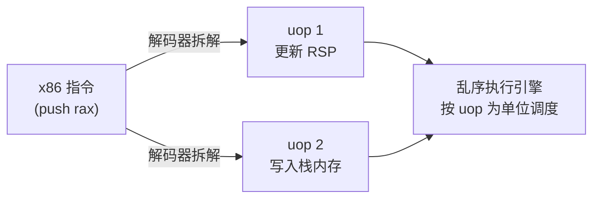
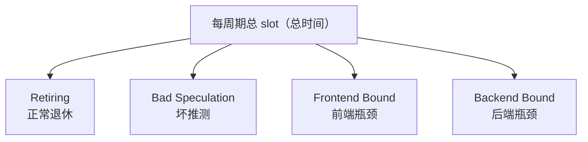

**TMA**（Top-down Microarchitecture Analysis，自顶向下微架构分析）是 Intel 提出的、基于**硬件性能计数器**的 CPU 瓶颈分析方法论（AMD 后来也支持）。核心思想：不去逐个翻几百个性能计数器，而是从"**流水线为什么没有满负荷工作**"这个顶层问题出发，把 CPU 时间**逐层分类**，最后定位到具体瓶颈。

## 核心概念

TMA 把 CPU 时间切成一个个小单元来统计，要理解这套体系，先建立三个概念：**Pipeline Slot**（流水线槽）、**uop**（微操作）、以及 uop 在流水线里的**旅程**（发射 → 执行 → 退休）。

### Pipeline Slot（流水线槽）

- 一个 CPU 每个周期能发射几条指令（如 4 发射 = 4-wide），每个发射位就是一个 **slot**
- TMA 把 CPU 时间切成 slot，然后统计每个 slot 花在了哪类事上
- **slot 是统一单位**：1 个 slot = 1 个发射位 × 1 个周期。4-wide 跑 1000 个周期就是 4000 个 slot，大小完全一样，所以能直接当分母算百分比
- 理想情况：所有 slot 都被 uop 占满，并且都顺利走完流程

### uop（微操作）：穿过 slot 的是什么

**uop**（micro-operation，微操作）是 CPU 内部实际执行的最小单位，不是汇编指令本身。x86 是复杂指令集（CISC），一条指令往往没法一步执行，解码器（Decoder）会把它**拆成若干个简单 uop**，再交给乱序执行引擎调度。



| 指令 | 拆成几个 uop |
|---|---|
| `add rax, rbx` | 1 个 |
| `push rax` | 2 个（更新 RSP + 写栈） |
| `mul` / `div` 等慢指令 | 多个 |

所以严格说，**一个 slot 就是"一个 uop 穿过流水线的座位"**——TMA 统计的对象是 uop，不是汇编指令。这些 uop 最后会被归入哪几类，下一节「四大类」正式定义。

### Issue / Execute / Retire（发射 / 执行 / 退休）：uop 的一生

uop 从诞生到"入账"要经过四道关卡，其中最后三关最容易混：


| 阶段              | 干什么                   | 说明                                  |
| --------------- | --------------------- | ----------------------------------- |
| fetch（取指）       | 从内存/指令缓存拿指令           | —                                   |
| decode（解码）      | 把指令拆成 uop             | 复杂指令拆得多                             |
| **issue**（发射）   | 把 uop 派发给执行单元端口（"派活"） | 每周期固定几个 = 发射宽度；slot 在这里被占掉          |
| **execute**（执行） | 执行单元真正开算（"干活"）        | 时长**不定**：`add` 1 个周期，`load` 可能几百个周期 |
| **retire**（退休）  | 结果正式写入寄存器/内存（"入账"）    | 对程序永久可见、不可撤销                        |

两个容易混的点：

- **发射 ≠ 执行**：发射是"派活"，执行是"干活"。slot 在发射那一刻被占掉，所以 slot 大小统一（1 个发射位 × 1 周期）；uop 之后执行多久（延迟 latency）不影响 slot 计数——等待造成的空 slot，会在下一节「四大类」里归类
- **执行 ≠ 退休**：执行完的结果先放"草稿区"（物理寄存器、重排缓冲区），只有退休"入账"后才永久生效；入账前都是可回滚的推测状态——猜错分支时草稿全部作废，这就是**被丢弃**（squash）

## 第一层：四大类

概念备齐了，第一层分类一句话就能概括：**把每个 slot 按"花在了哪"归进四类**。最理想的是退休——slot 全部用来干正事；其余三类都是不同程度的浪费。

| 分类                       | 含义                    | 翻译成人话                        |
| ------------------------ | --------------------- | ---------------------------- |
| **Retiring**（退休）         | uop 执行完且结果成功入账        | ✅ 干正事的时间，越高越好（但注意 uop 膨胀的假象） |
| **Bad Speculation**（坏推测） | 分支预测错误、被丢弃的乱序执行       | ❌ 猜错了，白干的活                   |
| **Frontend Bound**（前端瓶颈） | 取指、解码、L1i 缓存、分支预测器跟不上 | 饥渴：有活但"喂不进来"                 |
| **Backend Bound**（后端瓶颈）  | 执行单元、数据缓存/内存、寄存器端口不够  | 堵车：指令排队但"干不完"                |



这四个格子是怎么贴到 slot 上的？——**事后贴标签**，不是发射时定好的：

| slot 的状态 | 何时能确定归类 | 归入 |
|---|---|---|
| 被 uop 占用，最终正常退休 | 退休那一刻（未来才知道） | **Retiring** |
| 被 uop 占用，最终被丢弃 | 被丢弃那一刻（未来才知道） | **Bad Speculation** |
| 空着：前端没货可发 | 当时就知道 | **Frontend Bound** |
| 空着：后端排不下/等数据 | 当时就知道 | **Backend Bound** |

被 uop 占用的 slot，命运要等"退休还是被丢弃"揭晓；空着的 slot，原因当场就能看出。

为什么这套分类要按 uop 计数？三个要点：

- **四大类按 uop 计数**：Retiring 数的是正常退休的 uop，Bad Speculation 数的是被丢弃的 uop
- **uop 膨胀**（uop explosion）：一条指令拆出很多 uop（除法、复杂寻址等）时，Retiring 会虚高——按 uop 计数显得"在干活"，实际效率并不高，读结果时要留意这个假象
- **uop cache**（微指令缓存）：把解码好的 uop 缓存起来，下次直接取用、避免重复解码——它属于前端，Frontend Bound 高时常和它有关

## 第二层：往下细分

第一层只回答"堵在哪"，第二层继续回答"**为什么堵**"。第二层共 **8 个分类**，每个第一层类别往下二选一：轻量操作、繁重操作、分支误预测、机器清空、前端延迟、前端带宽、核心瓶颈、内存瓶颈。

| 第一层                 | 第二层（指标缩写）                  | 含义                                | 怎么区分                                 |
| ------------------- | -------------------------- | --------------------------------- | ------------------------------------ |
| **Retiring**        | `light`（轻量操作）              | 普通 ALU、跳转等简单指令                    | 占比高 = 健康                             |
|                     | `heavy`（**繁重操作**）          | 除法、慢浮点、微码指令                       | 占比高 = 指令选得低效，效率有水分                   |
| **Bad Speculation** | `br_mispredict`（**分支误预测**） | 分支方向/目标猜错                         | 此类最常见的来源                             |
|                     | `machine_clears`（机器清空）     | 非分支原因清空流水线（内存序违规、异常、中断）           | 罕见，一般不用管                             |
| **Frontend Bound**  | `fetch_latency`（前端延迟）      | 取指在等货：icache/ITLB 未命中、分支重取        | 偶尔堵一次、一堵很久（缓存未命中型）                   |
|                     | `fetch_bandwidth`（前端带宽）    | 送货慢：解码器、uop cache 带宽不够            | 每周期持续小堵（带宽饱和型）                       |
| **Backend Bound**   | `core_bound`（**核心瓶颈**）     | 执行端口不够、依赖链长、慢指令占端口                | 数据都在手边但"算不过来"                        |
|                     | `memory_bound`（**内存瓶颈**）   | 等数据：缓存/内存延迟、带宽、写缓冲（store buffer）满 | 数据"还没送到"（配合 `cache-misses` 看，通常显著偏高） |

> [!info] 这 8 项指标怎么来的
> 工具直接给出 4 个（`heavy`、`br_mispredict`、`fetch_latency`、`memory_bound`），另外 4 个由 L1 相减得到：`light = retiring − heavy`、`machine_clears = bad_spec − br_mispredict`、`fetch_bandwidth = frontend_bound − fetch_latency`、`core_bound = backend_bound − memory_bound`。

两个最有用的判断技巧：

- **核心瓶颈 vs 内存瓶颈**：一个"数据在手边但算不过来"（依赖链、端口争用），一个"数据还没送到"（等缓存/内存）——这个区分**直接决定优化方向是改算法还是改数据布局**
- **前端延迟 vs 前端带宽**：延迟是"偶尔堵一次、一堵很久"（icache 未命中这类），带宽是"每周期都差一点"（解码器满负荷）——前者查缓存未命中，后者查解码带宽/uop cache 命中率

再往下还有第三层：每个第二层分类还能继续细分（比如内存瓶颈还会再分延迟、带宽等），分类名随工具/CPU 而异、以实际输出为准，本文就不展开了——第二层已经足够定位主要瓶颈。

## 怎么看（perf 直接支持）

理论讲完了，怎么拿到这些数字？`perf` 直接内置了这套指标：`perf stat --topdown` 里的 **topdown 就是 TMA 方法在 perf 中的实现**——perf 把这套指标命名为 topdown（如 `topdown-retiring`、`topdown-backend-bound`）。

```bash
perf stat --topdown ./my_program
```

输出示例：

```
      retiring      bad speculation      frontend bound      backend bound
       35.2%             12.4%              18.7%               33.7%
```

（Intel VTune 的 µarch 分析用的也是同一套方法。）

## 怎么指导优化

拿到四类百分比后，**数值最高的那类就是主要瓶颈**，对应不同的优化方向。但小占比是常态，**不必什么都动**：

- 大致阈值（Intel 经验值，非铁律）：**Backend / Frontend Bound 超过 20%**、**Bad Speculation 超过 5%~10%**，才值得当作主要瓶颈去查；低于阈值属于正常噪音（偶尔的分支猜错、指令缓存冷启动、偶发资源冲突，谁都免不了）
- **一轮只打最大的那个**：测 → 找占比最高 → 针对性优化 → 重测 → 再看新的最高项，直到各项都回落到合理水平
- 目标不是消灭某类，而是让它**不再是主要矛盾**——有些瓶颈是工作负载本性决定的（如内存密集程序 Backend 天然高），压到同类水平即可

| 瓶颈 | 方向 |
|---|---|
| **Bad Speculation 高** | 分支预测问题：让分支可预测（减少数据依赖型分支、按分支方向重排数据） |
| **Frontend Bound 高** | 代码体积问题：icache 压力、函数过大、过度内联/展开，考虑代码布局 |
| **Backend Bound = 内存瓶颈** | 数据布局：cache 利用率、缓存行对齐、数据结构（配合 `cache-misses` 看） |
| **Backend Bound = 核心瓶颈** | 计算密集：算法换更少指令、SIMD 向量化、循环优化 |
| **Retiring 高 + 其他低** | 已经很健康；此时优化方向是**减少指令数**（算法层面） |

> [!tip] Retiring 高也别放松
> Retiring 是"干正事"，但不是免检：
> - 可能**虚高**：uop 膨胀（慢指令拆出很多 uop）让数字好看，实际低效
> - 可能**低效**：第二层里"繁重操作"占比大（除法、慢路径、开销大的调用），说明在高效地做低效的事，该换算法、少用慢指令
> - Retiring 高 ≠ 程序快：还要对比总指令数和 IPC

### uop 膨胀怎么办

**① 检测**——确认是不是真膨胀：

- 对比指令数：`perf stat -e instructions,uops_retired ./prog`，正常约 **1~1.5 个 uop/指令**，明显偏高（2+）就有膨胀
- 下钻第二层：Retiring 里"繁重操作"占比大，嫌疑坐实
- 关键判据：Retiring 数字漂亮，但**墙钟时间没变快**——这就是虚高的信号

**② 定位**——找是哪条指令在膨胀：

- `perf record` + `perf annotate` 看热点指令的反汇编
- `objdump -d` / `llvm-mca` 静态看每条指令拆几个 uop

| 常见膨胀源 | 拆多少 uop | 备注 |
|---|---|---|
| `idiv`（整数除法，**变量除数**） | 30+ | 最大头；常量除法编译器已自动优化，不用管 |
| `fdiv` / `sin`（x87 浮点微码指令） | 几十个 | 确保走 SSE 浮点，别用 x87 |
| `REP MOVS` 等串操作 | 按数据量 | 大块拷贝改用向量指令 |

**③ 对策**——从便宜到贵：

- **指令级**：变量除法绕开（预求倒数、牛顿迭代、查表）；大块拷贝交给 `-O3` 的向量化
- **编译器级**：`-O2` / `-O3`、`-march=native`（用上本机 SIMD 指令）；`-ffast-math` 能放开更多优化但**谨慎**（会改浮点语义）
- **算法级**：除法多的算法换成乘加为主；SIMD 向量化——一条向量指令干 4~8 个元素，uop 数不变、干活的量翻倍，膨胀率被摊薄

**④ 验证**——用墙钟时间验收，不要只看 Retiring 百分比（优化后总 uop 数下降，百分比可能变化不大）：

```
优化前：uops=1200万，Retiring 65%，跑 3.0 秒
优化后：uops=600万，  Retiring 58%，跑 1.8 秒   ← 这才是胜利
```

## 一句话总结

TMA = 把 CPU 时间按"流水线在哪浪费"分类的框架：先分四大类（Retiring / Bad Speculation / Frontend Bound / Backend Bound），再层层下钻，最后指向具体的优化动作——比单独看 `cycles`、`instructions`、`cache-misses` 更能直接回答"瓶颈到底在哪"。
